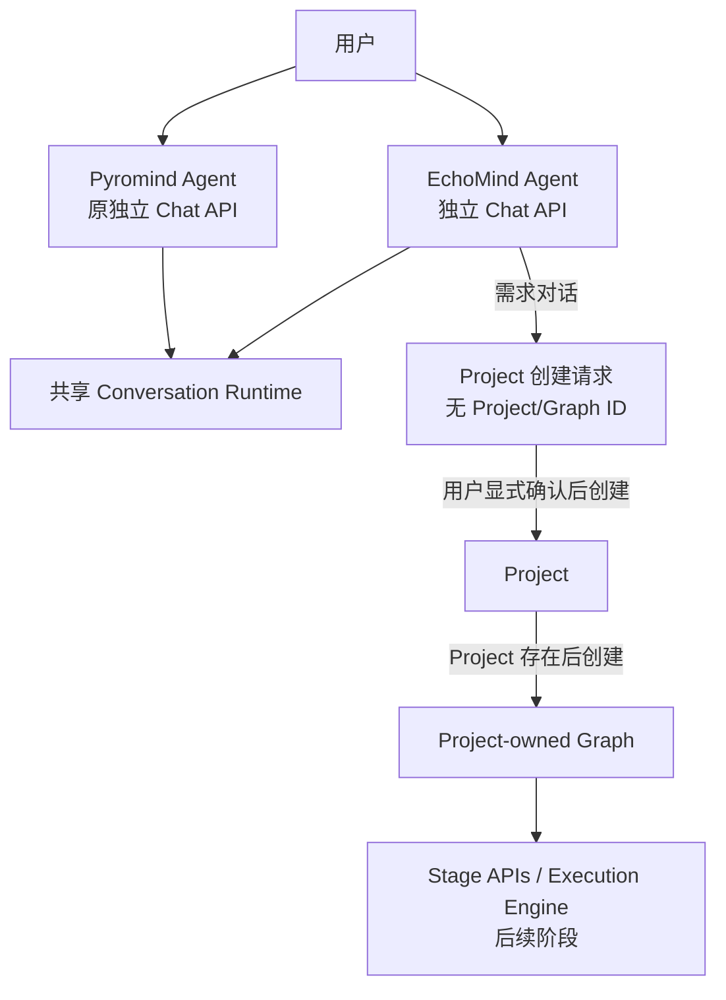

# EchoMind AVI 单轮 SFT/DPO 渐进式开发方案

> 状态：P0 工程基线、P1 AVI Skill/Graph 和 P1.5 Run/Artifact 执行契约已落地；
> P2a（development Dataset 节点启动 EchoMind Agent）已落地，P2b/P2c 待实现；
> 测试夹具和浏览器链路已验证，真实 LLM 首轮调用被外部 OpenRouter 网络阻断
> 更新时间：2026-10-29
> 范围：Pyromind Agent Server、Pyromind Agent、EchoMind Agent、Project/Graph、AVI 单轮训练链路

## 1. 目标

EchoMind 以 Project 为训练和实验单位，首期用 PCB AVI 单轮 SFT/DPO 跑通最小纵向闭环：

```text
Dataset -> Inference -> Evaluator -> Train
```

每个阶段都必须具备独立启动和验证能力，不能要求 Agent 长期在线担任调度器。首期先建立
两个独立 Agent、各自 Chat 接口、Project 生命周期和 Project-owned Graph，再逐步接入
AVI Skill 与四个阶段。

## 2. 已修正的核心认知

### 2.1 两个完全独立的 Agent

系统只有两个 Agent：

| Agent | 定位与职责 | Chat API | 会话 |
|---|---|---|---|
| EchoMind Agent | 新入口：理解需求、选择场景 Skill、补 checklist、形成 Project 创建请求；同时具备原 Agent 的完整开发能力 | `/api/echomind/conversations` | 独立 |
| Pyromind Agent | 原入口：保留现有对话、工作流画布、Skill、Tool 和调试能力，不参与 EchoMind 会话 | `/api/v2/pyromind/conversations`；旧直连入口兼容 | 独立 |

两者：

- 有各自的 Conversation、system prompt、Skill 白名单、Tool 白名单和权限契约。
- 不交接会话，不互相调用，不自动切换，不共享对话上下文。
- 共用 Conversation Runtime、事件持久化、取消和 SSE 等底座能力。
- 可以按各自权限访问同一个持久化业务资源，但这不构成 Agent 间通信或上下文传递。

`Workbench` 只是前端页面名称，不是第三个 Agent，也不是 EchoMind Agent。

### 2.2 不存在的概念

P0 不引入以下概念：

- `Scenario ID`
- `Scenario Run ID`
- `ScenarioSpec`
- `Scenario Executor`
- 创建 Chat 时自动创建 Run

这些标识会把“用户还在描述需求”和“项目已经进入执行”混在一起，导致错误的生命周期设计。

### 2.3 先创建 Project，再形成 Graph

正确流程是：

```text
用户描述目标
  -> EchoMind Agent 选择匹配 Skill
  -> EchoMind Agent 补齐 requirements checklist
  -> EchoMind Agent 写入 Project 创建请求（不含 Graph）
  -> 用户检查并明确确认“创建 Project”
  -> 服务端生成 project_id
  -> Project 持久化
  -> 在该 Project 下生成 Graph 容器
  -> 服务端按已确认的 Skill 选择 Graph 模板并写入节点和边
```

创建 EchoMind Chat 时不需要任何 Project、Graph、Scenario 或 Run ID。Project 创建前只存在
需求请求，Project 和 graph_id 都不存在。

### 2.4 Run 属于 Project 执行

Run 只会在 Project 和对应阶段存在，并且某个阶段被实际启动后产生：

```text
Project
  -> Graph
  -> Stage Run
  -> Execution Run
```

Run 不绑定 Chat 的创建动作，也不依赖某个 Agent 会话持续存活。

### 2.5 Dataset 在开发态和固化态有不同语义

EchoMind 是平台与 Agent 的组合能力，AVI demo 只提供业务参考，不定义 Dataset 的
平台执行模型。Dataset 阶段首期必须复用现有 `data-processing` Skill 和平台任务，
而不是在 EchoMind 内另建一套 JSONL、图片角色、标签和 split 校验引擎。

**开发态**的正确链路是：

```text
用户在 Project 中开始搭建 Dataset
  -> 同一个 EchoMind Agent 获得 Project/Stage 上下文
  -> Agent 使用 data-processing Skill
  -> 探查 Storage 数据和真实 Schema
  -> 选择数据处理范式，编写 Pipeline
  -> 在会话沙箱跑小样并展示结果
  -> 用户明确确认
  -> Agent 调用 df_submit_pipeline 提交全量验证任务
  -> 验证 StageRun 绑定 task_id/run_id/output_dir
  -> 用户检查产物并确认该 Dataset 节点验证通过
```

Dataset Agent 不是第三个 Agent，也不是一套独立的 Dataset 执行器。它仍是当前
EchoMind Agent 在 Dataset Stage 上下文中的一次开发任务。Graph 只表达阶段和依赖，
不应复制 `data-processing` Skill 的 SOP、AVI 标签规则或 Pipeline 实现。

**固化态**不再重复上述开发过程。完整 Graph 通过验证后，平台把 Dataset 节点冻结为
确定的执行规格：

```text
冻结 Pipeline URI + fingerprint
冻结 runtime URI + fingerprint
冻结输入引用和参数
冻结输出契约
```

此后启动 Dataset 是确定性执行：

```text
用户或调度器启动冻结后的 Dataset
  -> 平台按已冻结的执行规格提交任务
  -> 不询问小样、不等待用户确认、不要求 Agent 在线
  -> 平台回调更新 StageRun
```

小样和确认是 Graph 的开发验证门禁，不是 Dataset 固化后的运行门禁。

### 2.6 平台任务与 StageRun 的职责

- Agent 负责开发态方案、Pipeline、小样验证、用户确认和提交动作。
- 平台负责全量任务、资源调度、执行、重试基础和终态回调。
- StageRun 负责记录一次提交的输入引用、`task_id`、平台 `run_id`、`output_dir`、
  状态、错误和产物引用。
- 回调先更新 StageRun，再异步唤醒 Agent 生成解释或分诊；Agent 不在线不影响任务状态
  落盘。
- Agent 不轮询承担生产调度，也不能直接把未经验证的结果标记为成功。
- 开发验证 StageRun 和固化执行 StageRun 使用同一执行记录契约，但通过
  `purpose=validation|frozen` 区分；固化运行不依赖开发对话。

### 2.7 Project/Graph 最小生命周期

首期只引入两个必要状态：

```text
development -> frozen
```

- `development`：Graph 可变；Dataset 节点通过 Agent 搭建和验证。
- `frozen`：Graph 和每个节点的执行规格不可变；所有阶段由执行器运行
  `execution_spec`，不再调用 Agent 补配置。

首期不做完整版本树和回滚 UI。重新搭建流程时，从冻结 Graph 复制出新的
`development` Graph；“发布到生产”和事件调度仍属于后续阶段。

阶段验证和 Graph 固化不是同一个动作：

```text
node draft -> node validating -> node validated
                                      |
                    所有必需节点都 validated
                                      |
                                Graph frozen
```

- `node validated` 表示该阶段已有成功验证结果和候选执行规格，但 Project 仍是
  `development`。
- `Graph frozen` 只能在完整链路验证通过后发生。P2 只完成 Dataset 的验证和候选规格，
  不提前冻结整个 Project。

## 3. 整体架构



职责边界：

| 组件 | 负责 | 不负责 |
|---|---|---|
| EchoMind Agent | 需求澄清、Skill 选择、checklist、Project 创建请求；已进入开发任务时使用完整平台能力搭建、调试和验证 | 在确认前伪造 Project ID、提前生成 Project Graph、成为生产调度器 |
| Pyromind Agent | 原工作台内的开发态调试、修改 Graph/配置、验证阶段、辅助修复 | 接收 EchoMind 会话上下文、代替执行引擎长期运行生产流程 |
| Project Store | Project、Graph 和初始追溯信息的持久化 | Agent 对话上下文 |
| Execution Engine | 按发布后的稳定协议运行阶段和任务 | LLM 开放式规划 |

## 4. P0 API 契约

### 4.1 原 Pyromind Agent Chat 保持不变

Workbench Product Runtime：

```text
POST /api/v2/pyromind/conversations
GET  /api/v2/pyromind/conversations/{conversation_id}/snapshot
POST /api/v2/pyromind/conversations/{conversation_id}/commands
```

旧 Workbench OpenHands 直连接口继续兼容：

```text
POST /api/pyromind/conversations
POST /api/pyromind/conversations/{conversation_id}/messages
```

现有请求、响应、Skill、Tool 和 workflow canvas 行为保持不变。旧会话没有 profile 标记时，
服务端按 Pyromind Agent 解释。

### 4.2 EchoMind Chat 是独立入口

```text
POST /api/echomind/conversations
GET  /api/echomind/conversations/{conversation_id}/snapshot
POST /api/echomind/conversations/{conversation_id}/commands
GET  /api/echomind/conversations/{conversation_id}/project-request
```

创建 EchoMind Chat 的请求不包含任何业务 ID：

```json
{
  "llm": {
    "model": "gpt-4o",
    "api_key": "..."
  },
  "message": "我要做一个 AVI 图片质检训练流程"
}
```

EchoMind Profile 由服务端固定。它与 Pyromind Agent 使用相同的 Tool 白名单，并保留原
Agent 的全部开发能力；Skill 白名单在共享能力之上仅多出 `avi-single-turn`。客户端不能通过
`extra`、标签或消息切换 Profile 或注入 Tool。

EchoMind Agent 在需求信息齐备后，将 **Project 创建请求** 写入自己的 conversation workspace：

```text
public_data/project_request.json
```

请求由服务端读取和校验，前端通过 `project-request` 接口展示，不把聊天文本解析成业务对象。
该文件只包含项目名称、描述、匹配 Skill 和 requirements，不包含 Graph。

### 4.3 Project 创建是显式动作

```text
POST /api/echomind/projects
GET  /api/echomind/projects/{project_id}
POST /api/echomind/projects/{project_id}/nodes/{node_id}/start
POST /api/echomind/projects/{project_id}/nodes/{node_id}/run
POST /api/echomind/projects/{project_id}/freeze
GET  /api/echomind/projects/{project_id}/runs
GET  /api/echomind/projects/{project_id}/artifacts/{artifact_id}
```

创建请求：

```json
{
  "conversation_id": "echomind-conversation-id",
  "confirmed": true
}
```

Dataset `start` 响应：

```json
{
  "schema_version": 1,
  "project_id": "server-generated",
  "graph_id": "server-generated",
  "node_id": "dataset",
  "conversation_id": "source-echomind-conversation",
  "event_id": "server-generated-internal-event",
  "status": "started"
}
```

规则：

- `confirmed=true` 表示用户已经完成显式确认。
- 服务端校验 conversation 属于 EchoMind Profile 和当前用户。
- 服务端读取 `project_request.json`，重新执行完整 Schema 校验。
- `project_id` 只能由服务端在确认后生成，客户端不能提前提交。
- Project 创建成功后才生成 Project-owned Graph 容器和 `graph_id`。
- 未注册模板的 Skill 创建空 Graph 容器；AVI Skill 由服务端模板注册表生成四节点 DAG。
- Project 保存 `echomind_conversation_id`，仅用于追溯来源，不建立 Agent 间通信。
- `freeze` 只有在全部必需节点都进入 `validated` 后才能成功。
- `development` Graph 拒绝固定执行 `run`，`frozen` Graph 拒绝重新进入 Agent 开发的
  `start`。
- P2a 中 `start` 不创建 StageRun；它只确认服务端已向原 EchoMind conversation 注入
  Project/Stage 上下文并启动 Agent。
- P1.5 的 executor probe 在 `development` 中暂时保留，用于其他尚未接入真实执行器的
  节点；`launch_mode=agent` 的节点始终拒绝 `run`。

节点有两种启动入口：

- `start` 只用于 `development` Graph 中 `launch_mode=agent` 的阶段，把 Project/Stage
  上下文交给当前 EchoMind conversation。
- `run` 只用于 `frozen` Graph 中 `launch_mode=executor` 的阶段，按冻结执行规格启动
  确定性执行器。

P1.5 四个 AVI 节点当前都绑定 `contract_probe` executor，用于验证 Run 状态、持久化和
Artifact 登记链路，不执行真实数据、推理、评估或训练，也不会修改已持久化的 Graph。
后续替换某个 executor 时，Project、节点 ID、拓扑、Run 和 Artifact 契约保持不变。
P1 已创建且仍保存 `shell` executor 的 Project 通过兼容映射执行同一 contract probe，
避免升级后旧 Project 不可运行。

Dataset 在 `development` 中通过 `start` 进入 EchoMind Agent，完整 Pipeline 由
`data-processing` Skill 生成并在会话沙箱验证。完整 Graph 验证通过后，`freeze` 生成
不可变的 Dataset `execution_spec`。此后 Dataset 通过 `run` 直接提交冻结 Pipeline，
阶段执行记录从平台任务受理开始，由 Task Association 与 Kafka/Webhook 回调更新。

## 5. 最小 Project 与 Graph

Project 是独立于 Conversation 的产品资源。现有 `VersionProject` 与 Conversation 一对一，
属于版本工作区，不是本方案的 Project，不能直接替代。

P0 使用文件持久化，目录结构建议为：

```text
projects/<project_id>/
  project.json
  graph.json
  runs/<run_id>.json
  artifacts/<artifact_id>.json
```

`project.json` 至少包含：

```text
schema_version
project_id
name
description
skill
requirements
owner_user_id
echomind_conversation_id
lifecycle
frozen_at
created_at
```

`graph.json` 至少包含：

```text
schema_version
graph_id
project_id
lifecycle
nodes
edges
```

`lifecycle` 首期只允许 `development` 和 `frozen`。`development` 允许 Agent 继续完善
节点配置；`frozen` 禁止原地修改 Graph。

对于没有注册 Graph 模板的 Skill，`graph.json` 是 Project 创建后的空容器：

```json
{
  "schema_version": 1,
  "graph_id": "server-generated-after-project-creation",
  "project_id": "server-generated",
  "lifecycle": "development",
  "nodes": [],
  "edges": []
}
```

首期只开放以下节点类型：

```text
dataset
inference
evaluator
train
```

AVI 单轮 Skill 在 Project 创建后生成的 `development` Graph：

```json
{
  "schema_version": 1,
  "graph_id": "server-generated",
  "project_id": "server-generated",
  "template": "avi-single-turn/v1",
  "lifecycle": "development",
  "nodes": [
    {
      "id": "dataset",
      "type": "dataset",
      "title": "Dataset",
      "status": "idle",
      "launch_mode": "agent",
      "config": {
        "capability": "data-processing",
        "platform_task_kind": "data_preparation",
        "input_hint": "datasets/avi/train.jsonl",
        "validation": {
          "status": "draft",
          "validation_run_id": null,
          "candidate_execution_spec": null
        }
      }
    },
    {
      "id": "inference",
      "type": "inference",
      "title": "Inference",
      "status": "idle",
      "executor": "contract_probe",
      "config": {
        "model": "Qwen/Qwen3-VL-4B-Instruct",
        "dataset_ref": "dataset.dataset"
      }
    },
    {
      "id": "evaluator",
      "type": "evaluator",
      "title": "Evaluator",
      "status": "idle",
      "executor": "contract_probe",
      "config": {
        "predictions_ref": "inference.predictions",
        "rule": "result match; primary metric fail_recall",
        "artifact_format": "atif"
      }
    },
    {
      "id": "train",
      "type": "train",
      "title": "Train (SFT)",
      "status": "idle",
      "executor": "contract_probe",
      "config": {
        "method": "sft",
        "dataset_ref": "dataset.dataset",
        "evaluation_ref": "evaluator.report",
        "artifact_goal": "LoRA checkpoint and ATIF evaluation report"
      }
    }
  ],
  "edges": [
    {"source": "dataset", "target": "inference"},
    {"source": "inference", "target": "evaluator"},
    {"source": "evaluator", "target": "train"}
  ]
}
```

Dataset 节点中的 `input_hint` 只是启动探查的线索，不是已确认的数据契约。真实格式、
图片角色、标签和 split 信息由 Agent 在执行 `data-processing` 时探查并写入本轮
StageRun/Artifact，不进入 Graph 的固定节点配置。

完整 Graph 验证通过后，服务端生成 `frozen` Graph。Dataset 节点从 Agent 启动器转换
为确定性执行器：

```json
{
  "id": "dataset",
  "type": "dataset",
  "title": "Dataset",
  "status": "idle",
  "launch_mode": "executor",
  "executor": "frozen_data_processing",
  "config": {
    "execution_spec": {
      "input_uri": "datasets/avi/train.jsonl",
      "pipeline_uri": "/.pyromind-agent/<run>/data_preparation/<id>/pipeline.py",
      "pipeline_sha256": "sha256",
      "runtime_uri": "/.pyromind-agent/<conversation>/data_preparation/runtime-cache/<fingerprint>",
      "runtime_fingerprint": "sha256",
      "support_file_uri": null,
      "model_profile": "vision",
      "output_schema": "structured",
      "convert_format": "none",
      "cpu": 4,
      "memory": 64,
      "validation_run_id": "<successful validation StageRun>",
      "output_contract": {
        "processed": "processed.jsonl",
        "report": "report.json"
      }
    }
  }
}
```

冻结操作必须从一次成功的验证 StageRun 生成，不接受客户端直接提交 Pipeline 路径、
Runtime 路径或 fingerprint。固化后 Dataset 启动直接使用该 `execution_spec`，不会再
触发 `data-processing` 的小样和用户确认流程。

服务端必须校验：

- Project 创建请求不能包含 Graph、Project ID 或 Graph ID。
- 模板只能由服务端按 Skill 名称选择，Agent 不能提交任意节点或边。
- 节点 ID 唯一。
- Edge 引用的节点存在。
- 不支持自环和明显 Cycle。
- 节点类型在首期白名单内。
- 节点 config 是可持久化的 JSON object。
- Project 与 Graph 的 ID 不接受客户端伪造。
- Dataset 节点不得承载通用数据清洗逻辑、自由文本 Prompt 或未经验证的数据 Schema。
- `development` Graph 中的 Dataset 只能启动 Agent 开发，不能直接执行清洗代码。
- `frozen` Graph 中的 Dataset 必须具有完整 `execution_spec`，且不能再启动开发 Agent。

## 6. Profile 组织

Profile 差异不能藏在通用 Skill 或 Tool 中。每个 Agent 使用一份显式配置清单：

```text
agent_profiles/
  spec.py
  echomind.py
  pyromind.py
```

配置清单负责声明：

- profile 名称和 usage id。
- system prompt。
- Skill 白名单。
- Tool 白名单和专属 Tool 参数。
- 确认策略和输出契约。

Router 只负责选择固定 Profile、组装 Conversation 和调用共享 Runtime，不根据用户消息动态
切换 Agent。workflow canvas、文件编辑、sandbox、训练和工作流提交等能力直接由各自 Profile
的 Skill/Tool 白名单约束，不维护没有执行语义的重复权限布尔字段。

## 7. 共享能力隔离

共享能力分三层：

| 层级 | 内容 | 是否允许角色语义 |
|---|---|---|
| Kernel | Conversation、事件、持久化、SSE、取消、文件系统 | 不允许 |
| Shared capability | 通用数据处理、评测、工作流能力 | 不允许 |
| Profile | prompt、Skill/Tool 白名单、权限、输出契约 | 允许 |

约束：

- 通用 Tool 收到相同输入时必须产生相同行为，不能判断调用方是 EchoMind Agent 还是
  Pyromind Agent。
- 需要不同行为时，新增专属 Tool 或 Profile wrapper，不在共享 Tool 内加
  `if profile == ...`。
- Profile 身份只能用于鉴权、审计和入口校验，不能成为隐式业务参数。
- AVI 标签、图片角色、Evaluator 规则和训练格式属于场景 Skill，不进入通用 Tool。
- 首期 EchoMind 与 Pyromind 使用相同的 Tool 白名单，包括 sandbox、数据处理、工作流生成、
  提交和调试能力；EchoMind 的 Skill 白名单只额外包含 `avi-single-turn`。
- 后续新增的 EchoMind 场景 Skill 只追加到 EchoMind Profile。若需要不同 Tool 行为，应新增
  专属 Tool 或 Profile wrapper，不能在共享 Tool 内按 profile 写业务分支。
- EchoMind 的 Prompt 描述需求澄清和 Project 创建边界，Pyromind 的 Prompt 保持原开发工作台
  行为；两者不互相引用职责说明。

## 8. AVI 单轮场景

`avi-single-turn` 已作为 EchoMind Agent 专属场景 Skill 落地。它只负责定义场景配方：

- 需求 checklist。
- 图片角色约定：`defect`、`diff`、`gt`。
- 标签约定：`pass`、`fail`、`defect`。
- 单轮输出 Schema。
- Project 创建后要使用的 Graph 节点和边模板。
- SFT/DPO 分支选择。

场景 Skill 不实现 Stage 状态机、Run 持久化或平台任务提交。Skill 先完成澄清，并要求
Agent 将完整 requirements 写入 `public_data/project_request.json`。用户明确创建 Project
后，服务端按 `skill=avi-single-turn` 选择 `echomind_graph_templates.py` 中的
`avi-single-turn/v1` 模板，生成并持久化四节点 DAG。

这种分工保证：

- Project 创建前只有需求和 Skill 选择，没有伪造的 Graph 或业务 ID。
- Agent 不能自由写 Project-owned Graph，节点类型、拓扑和状态由服务端校验。
- 场景知识留在 Skill，执行器选择和持久化边界留在平台。
- AVI Skill 中的图片角色、标签和训练语义是场景参考；Dataset 的真实 Schema 仍由
  `data-processing` 在 Project 内探查确认，不提前写入 Graph。
- 当前四阶段都能从 UI/API 单独触发，P1.5 只执行 `contract_probe`，不进入业务执行器。

Skill 文件：

```text
.agents/skills/avi-single-turn/SKILL.md
.agents/skills/avi-single-turn/references/requirements.md
.agents/skills/avi-single-turn/references/data-contract.md
.agents/skills/avi-single-turn/references/evaluation.md
.agents/skills/avi-single-turn/references/graph-template.md
```

各阶段实现方向：

| 阶段 | 首期实现 |
|---|---|
| Dataset 开发态 | EchoMind Agent 使用现有 `data-processing` Skill 开发 Pipeline，小样确认后提交全量验证任务 |
| Dataset 固化态 | 平台按冻结的 Pipeline/runtime/input/output spec 直接提交任务，不再调用 Agent 或重复确认 |
| Inference | 平台推理任务，输出 canonical predictions 和错误分类 |
| Evaluator | CPU-only 确定性评分，可从 predictions 独立重跑 |
| Train | 生成并校验工作流 DSL，通过平台工作流执行 SFT/DPO |

Train 的实际执行单位是平台工作流任务，不采用 demo 中直接 patch 工作流 JSON 的方式。
Dataset 同样不复制 DataFlow/EDP 处理逻辑；`data-processing` 是开发态唯一的数据处理
流程入口，固化态只执行它已经产出的冻结 Pipeline。

## 9. Template 与 Demo 借鉴范围

### 9.1 AVI demo

参考 `/Users/zhangpeng/PycharmProjects/AVI-test-echomind-demo`：

- 单轮图片角色和判定输出。
- 数据检查与预测结果展示。
- 评测规则和 badcase 定位方式。
- 阶段结果如何关联输入和产物。
- 业务主指标 `fail_recall`，持平时用严格 `accuracy` 兜底。
- `pass`、`fail`、`defect` 三分类及 fail 漏检优先的业务语义。

Demo 不是 EchoMind 的平台架构模板。Dataset 开发态的探查、小样、全量验证、异步任务
和报告链路以平台 `data-processing` 为准；固化态执行冻结 Pipeline，不重复小样和确认。
AVI demo 只提供领域语义和展示参考。

### 9.2 trajectory_viewer examples

参考 `/Users/zhangpeng/PycharmProjects/trajectory_viewer/examples`：

- 用 ATIF-v1.7 表达单轮和多轮轨迹。
- `defect`、`diff`、`gt` 三张图片带显式角色。
- GT/prediction、reason、box、reward 和 badcase 可在同一轨迹中回看。
- PCB、defect、multimodal、single-turn、multi-turn 等模板共用标准数据格式，
  场景差异通过渲染模板和扩展字段承接。

首期不照搬：

- 在线 feeder/tracer 自动封批。
- Kafka checkpoint 流。
- 线上推理热切换和 candidate incumbent。
- 为每条样本创建 Chat Conversation。
- 直接 patch 工作流 JSON 的实现。

## 10. 渐进式开发与验证

### P0：双 Agent 与最小 Project/Graph

状态：工程骨架已落地（2026-10-29），真实 LLM 多轮 E2E 待验证。

交付：

- 拆分 Pyromind Agent 和 EchoMind Agent 的显式 Profile 配置。
- 新增独立 EchoMind Chat API 和消息 API。
- EchoMind Agent 具备与 Pyromind Agent 相同的全部 Tool、workflow canvas 和认证上下文
  能力，Skill 白名单仅额外加入 `avi-single-turn`。
- EchoMind Agent 可以只凭用户目标开始对话，不需要任何业务 ID。
- EchoMind Agent 将不含 Graph 的 Project 创建请求写入 conversation workspace。
- EchoMind Agent 可加载 `sandbox` Skill，并使用 create/terminal/file/delete 等远端
  sandbox 工具做开发期验证。
- 新增 Project 创建请求查询接口。
- 用户显式确认后调用 Project API，服务端校验请求并生成 Project ID。
- Project 创建后生成 Project-owned Graph；未注册 Skill 使用空容器，AVI Skill 使用四节点
  模板。
- 新增 Project 查询接口和单节点 executor 启动接口。
- 新 Workbench 使用 `/api/v2/pyromind/conversations`；旧
  `/api/pyromind/conversations` 行为保持兼容。
- 前端新增 EchoMind Chat，移除 Scenario/Run/Project 输入框；创建 Project 后才展示服务端
  生成的 Project ID 和 Graph。
- EchoMind Chat 保存当前用户最近一次会话和 Project ID；刷新页面后通过 EchoMind 独立接口
  校验会话、恢复历史事件、Project request 和 Project/Graph。
- EchoMind Chat 左侧提供独立会话列表，可按标题、状态、短 ID 和更新时间选择会话；列表
  只包含 EchoMind Profile，不展示或进入 Pyromind Agent 会话。

P0 当前入口：

```text
Pyromind Agent / Workbench UI: /
EchoMind Agent UI:                /?chat=echomind&userId=<debug-user-id>
Pyromind Product API:             /api/v2/pyromind/conversations
EchoMind Agent API:               /api/echomind/conversations
Project API:                      /api/echomind/projects
```

验证：

1. 两个 Chat 创建后分别使用自己的 prompt 和 Profile；Tool 白名单一致，EchoMind 仅额外
   加载 `avi-single-turn`。
2. EchoMind Agent 没有 Project 时也能正常对话。
3. 创建 EchoMind Chat 的请求不能携带 Scenario、Run 或 Project ID。
4. 客户端不能切换 EchoMind Agent 的 Profile 或注入 Workbench Tool。
5. EchoMind Agent 消息接口拒绝 Pyromind Agent conversation，反之亦然。
6. EchoMind Agent 未写 Project 创建请求时，Project API 明确失败。
7. Project 创建请求如果包含 Graph、Project ID 或 Graph ID，服务端明确拒绝。
8. 合法确认后只创建 Project，再生成 Project-owned Graph；未注册 Skill 为空容器，
   AVI Skill 为四节点 DAG。
9. 旧 Workbench Chat 创建、消息、workflow canvas、Skill 和 Tool 测试无回归。
10. EchoMind Chat 刷新后恢复当前会话，历史消息和 Project 信息不丢失；已失效会话回到
   新会话状态。

退出标准：接口、Profile、Project/Graph 生命周期稳定，旧 Agent 零回归。

### P1：轻量 AVI Skill

状态：AVI Skill 和四节点 Graph 已落地（2026-10-29）。

交付：

- `avi-single-turn` Skill。
- requirements checklist。
- Project 创建请求 Schema 和 AVI Graph 参考。
- 服务端固定模板 `avi-single-turn/v1`。
- 四阶段节点和独立启动接口。
- 前端四阶段卡片和节点启动入口。
- 3 到 5 条黄金样本待补。

验证：

- EchoMind Agent 能识别 AVI 场景并选中 Skill。
- checklist 缺项时不会声称可以创建 Project。
- 生成的 Project 创建请求能通过 P0 服务端校验。
- Project 创建后，服务端模板生成的 AVI 节点和边写入该 Project 的 Graph。
- 四个节点都能独立点击启动，并明确返回执行器未实现，不产生业务任务或 Artifact。

P1 验收记录（2026-10-29）：

- 后端双 Agent 定向回归 `48 passed`，Tool 回归 `2 passed`。
- EchoMind 会话创建接口实际返回 `201`，确认独立 API 可启动。
- 使用符合 Skill 契约的 Project request 测试夹具调用 Project API，返回 `201` 和
  `avi-single-turn/v1` 四节点 DAG。
- Dataset、Inference、Evaluator、Train 四个节点运行接口都返回 `not_implemented`，
  未创建外部任务或 Artifact。
- Playwright 使用真实后端和前端走通 Project request 展示、Project 创建、四阶段 Graph
  和节点启动反馈；发现 4 个运行按钮且无浏览器控制台错误。
- 真实 EchoMind 消息已进入 Agent，但 OpenRouter 返回连接错误，首轮模型没有生成 token；
  因此“模型自主完成 Skill 澄清并写 request”仍需网络恢复后复验。
- 真实启动同时暴露并修复了 `submit_workflow` Tool 不接收 resolver `conv_state` 的装配
  错误；该问题会阻断完整 Pyromind/EchoMind Agent 创建，不只是 AVI 场景。
- 已补齐 EchoMind 独立会话/历史读取接口与前端本地会话恢复。Playwright 使用真实
  EchoMind 会话验证会话列表、切换会话、浏览器刷新恢复历史消息和 Project request，
  页面无 console error 或失败请求。

### P1.5：Run/Artifact 执行契约

状态：后端、前端和持久化链路已落地（2026-10-29）。

目标：在接入任何真实业务 executor 前，固定所有阶段共享的最小执行合同，避免 P2-P5
各自定义状态和产物格式。

交付：

- `StageRun`：记录 Project、节点、executor、状态、错误、时间和产物引用。
- `ProjectArtifact`：记录产物类型、格式、URI、内容摘要和大小。
- `POST .../nodes/{node_id}/run` 创建真实 Run，不再返回临时 shell 响应。
- `GET .../runs` 恢复 Project 的 Run 历史。
- `GET .../artifacts/{artifact_id}` 读取持久化产物内容。
- `contract_probe` executor：只生成 `stage_contract_probe` 产物，不冒充业务成功。
- 前端按每个节点最近一次 Run 展示状态，并支持刷新恢复和 Artifact 预览。

验证：

- Run 先以 `running` 落盘，再推进到 `succeeded` 或 `failed`。
- Project 不保存易失的节点运行结果，Graph 继续只表达拓扑。
- 服务进程重启后仍能列出 Run、读取 Artifact。
- 执行失败会持久化结构化错误，不留下只存在内存中的状态。
- 通用 Tool、Skill 和 Pyromind Agent 不感知 EchoMind Run/Artifact。

### P2：Dataset 与平台 data-processing 打通

状态：P2a 已实现；P2b、P2c 待实现。

P2 不实现独立 Dataset Schema 引擎，也不把 `data-processing` 的 SOP 复制到 Tool 或
Stage Executor。P2 的核心是区分 Dataset 的两个形态：

```text
development Dataset
  -> Agent 开发、小样、验证、用户确认

frozen Dataset
  -> 确定性执行已冻结的 Pipeline，无 Agent 确认
```

#### P2a：development Graph 的 Dataset 节点

已实现：

- Project 和 Graph 持久化 `lifecycle=development`，节点持久化
  `launch_mode=agent|executor`；旧 Project 缺省按 `development` / `executor` 读取。
- `POST .../nodes/{node_id}/start` 校验 Project owner、development 生命周期、Dataset
  类型和 `data-processing` capability，然后向 Project 记录的 EchoMind conversation
  注入服务端生成的项目上下文并立即 `run`。
- `start` 不创建第三个 Agent、不创建新 conversation、不伪造 StageRun；前端提示
  Dataset 开发已在原 EchoMind Chat 中启动。
- `run` 拒绝 `launch_mode=agent` 的节点；尚未替换的 executor 节点继续走
  `contract_probe`。
- AVI Dataset 节点只保存 `capability=data-processing`、
  `platform_task_kind=data_preparation`、`input_hint` 和 `validation=draft`，不再把
  固定格式、图像角色或标签 Schema 当作执行配置。
- EchoMind Profile Prompt 要求 Dataset 开发先探查真实 Storage 数据、生成 Pipeline、
  跑小样，并在用户明确确认后才提交全量验证。

交付：

- Project UI 的 Dataset 启动动作把当前 Project 和 `dataset` 节点上下文交给同一个
  EchoMind conversation，不创建第三个 Agent。
- `development` Project 的 Dataset 节点使用 `launch_mode=agent`，配置只声明
  `capability=data-processing` 和 `platform_task_kind=data_preparation`。
- EchoMind Prompt 明确：Dataset 开发必须先进入 `data-processing` Skill，完成探查、
  选型、Pipeline、小样和用户确认门禁。
- 前端展示 Agent 正在开发 Dataset，而不是伪造一条已执行的 `contract_probe` Run。

验证：

- [已通过单测] 用户在 Project 中点击 Dataset 后，EchoMind Chat 获得 Project/Stage
  上下文、Graph/节点 ID 和 data-processing 操作约束。
- [已通过单测] 跨用户、冻结 Project、错误 Agent Profile 和 Agent 节点 `run`
  请求均被拒绝。
- [待在线验证] Agent 读取真实 Storage 数据并产生小样结果。
- Agent 能读取 Storage、发现真实数据结构并选择 `data-processing` 范式。
- Agent 在会话沙箱产出小样结果；用户未确认时不能提交全量任务。
- 全量验证任务产生 `purpose=validation` 的 StageRun，可通过平台回调查看产物和错误。
- 通用 `data-processing` Skill 和 Tool 不出现 EchoMind、Project 或 AVI 分支。

#### P2b：生成 Dataset 候选执行规格

交付：

- Dataset 全量验证成功后，服务端从验证 StageRun 和
  `DataPreparationTaskAssociation` 生成候选执行规格，包含 Pipeline、Runtime、输入、
  参数和输出契约。
- Dataset 节点标记为 `validated`，但仍属于 `development` Project。
- 完整 Graph 的所有必需阶段都 `validated` 后，才执行 Project 级冻结；P2 不提前把
  整个 Project 标记为 `frozen`。
- 固化只接受服务端校验过的验证结果，不接受 Agent 或客户端自行拼接的 Pipeline 路径。
- `frozen` Project 的 Graph 不可编辑；重新搭建流程时复制出一个新的 `development`
  Graph，后续再设计版本树。
- Project 级冻结构建 Dataset 节点的最终 `execution_spec`，把
  `launch_mode` 改为 `executor`，并移除 Agent 开发入口。

验证：

- Dataset 节点可独立从 `draft` 进入 `validated`，不要求其他阶段先完成。
- 候选执行规格能追溯到验证 StageRun、Pipeline fingerprint 和输入引用。
- 未验证成功的 Dataset 不能进入 `validated`。
- Project 仍为 `development` 时不能通过固定执行入口运行候选规格。

#### P2c：frozen Dataset 执行

交付：

- `POST .../nodes/dataset/run` 对 `frozen` Graph 直接使用 `execution_spec` 提交平台
  任务，不进入 Agent 对话。
- 冻结执行创建 `purpose=frozen` 的 StageRun，并记录
  `task_id/run_id/output_dir/input_refs`。
- 执行器复用平台 DataFlow/EDP 提交协议，但使用冻结文件，不重新生成 Pipeline。
- Dataset 输入首期固定为 `execution_spec.input_uri`；事件触发和动态输入留到后续。
- Kafka/Webhook 终态先更新 StageRun，再可选唤醒 EchoMind Agent 做结果解释或失败分诊。
- StageRun 状态至少覆盖等待中、运行中、成功、失败和取消；平台原始状态保留用于追溯。
- `report.json`、`processed.jsonl`、`failure.json`、`validation.json` 以 Storage URI
  登记为 Artifact，不把全量数据复制进 Project 文件存储。
- 前端通过 StageRun 展示外部任务状态，并通过现有进度读取能力展示
  total/processed/failed/ETA；失败时可从 `output_dir` 查看报告。
- 冻结执行失败后，Agent 可以作为一次独立修复任务读取错误并辅助修改流程；修复必须
  回到 `development` 产生新冻结版本，不能直接修改运行中的 `execution_spec`。

验证：

- 使用测试夹具构造 `frozen` Graph，验证 `frozen_data_processing` executor 不依赖
  Agent、conversation 或 `data-processing` Skill。
- 回调在 Agent 不参与时可以完成 StageRun 落盘。
- 重复回调幂等，旧任务回调不会覆盖新的 StageRun。
- 成功任务能定位 report 和 processed data；失败任务能定位 error/report/failure。
- 冻结后的 Dataset 可在不启动 Agent、不跑小样、不要求确认的情况下独立启动。
- Agent 在线时可被失败回调唤醒解释结果；Agent 不在线时任务状态仍可查询。

#### P2 边界

- 只支持 `data-processing` 已支持的数据处理能力，不新增 Dataset 通用协议。
- 首期不实现数据 Schema、图片角色、标签或 split 的独立校验器。
- 首期固化的是 Project 内可执行的 Dataset 节点，不实现生产态事件触发和循环调度。
- P2 只生成并验证 Dataset 候选规格；整个 Graph 的冻结入口在完整链路验证完成后启用。
- 首期为避免 task 到 Project 的歧义，一个 EchoMind conversation 只对应一个 active
  Project；多 Project 切换另行设计。
- 小样和用户确认只存在于 `development`，不得进入 `frozen_data_processing` 执行器。

### P3：Inference

交付：

- 推理任务提交与 prediction Artifact。
- 请求失败、解析失败和缺失结果分类。

验证：

- 不依赖 Evaluator 也能确认预测覆盖率和来源。

### P4：Evaluator

交付：

- CPU-only 确定性评分。
- accepted/rejected 和 metrics。

验证：

- 同一 predictions 连续评分结果一致。
- 不申请 GPU，不调用被测模型。

### P5：SFT Train

交付：

- SFT 数据物化。
- DSL 生成、校验、debug 和平台提交。
- checkpoint、task_id、日志和输入 Artifact 关联。

验证：

- 小样训练进入明确终态。
- 训练期间不要求 Agent 在线调度。

### P6：训后闭环与 DPO

交付：

- checkpoint 再次 Inference 和 Evaluator。
- baseline/after 对比。
- DPO chosen/rejected 校验和训练分支。

退出标准：完成一次 AVI 单轮 SFT 闭环，并可独立验证 DPO 分支。

## 11. 每阶段验证矩阵

| 验证类型 | 要求 |
|---|---|
| Chat | 两个 Agent 入口独立，不能互相操作对方的 conversation |
| API | Project 和 Stage 状态可直接查询；Dataset 开发通过 EchoMind Chat 启动，固化 Dataset 通过 run API 直接执行 |
| Schema | Project 创建请求、Project、Graph 和产物均有服务端校验 |
| 持久化 | 服务重启后可恢复，创建失败不留半状态 |
| 追溯 | Project 能追溯到 EchoMind conversation、Graph 和后续 Run |
| 失败 | 配置错误、Schema 错误、外部任务失败和解析失败可区分 |
| 平台任务 | validation/frozen Dataset 的 task_id/run_id/output_dir 可幂等绑定到唯一 StageRun，回调先记账再唤醒 Agent |
| Skill 边界 | Dataset 开发走 `data-processing`；固化执行只读冻结 Pipeline，不重复调用 Skill 或确认门禁 |
| 回归 | 原 Pyromind Agent Chat 的创建、消息、SSE 和 workflow 能力不变 |
| 污染 | 通用 Skill/Tool 不出现 EchoMind Agent 或 AVI 专属分支 |

## 12. 非目标

首期暂不做：

- 生产态事件调度和完整执行引擎。
- 图版本管理和回滚 UI。
- 两个 Agent 之间的协作、交接或额外常驻 Manager Agent。
- 多场景并行编排。
- 在线数据持续采集。
- 评估 UI 的完整模板系统。
- 完整权限矩阵和项目成员体系。
- 独立 Dataset Schema、数据指纹或 split 泄漏校验引擎。
- 用 Agent 常驻轮询代替平台任务回调。

## 13. 风险与后续决策

1. EchoMind Agent 的 Project 创建请求文件是 P0 的轻量平台状态；如果后续需要多端实时
   预览，再迁移为专用 Request Store。
2. Project/Graph 首期使用文件存储；执行引擎接入前需要决定是否迁移 Product Store。
3. AVI 黄金样本来源、标签和坐标口径需要在 P1 冻结。
4. DPO pair 的人工策略和自动生成边界需要在 P6 前明确。
5. 版本与回滚首期只保留 Project、Graph、Run 和 Artifact ID 的可追溯性，不做完整版本树。
6. P2 需要一个 EchoMind conversation 与 active Project 的一对一约束；多 Project
   并存时，必须通过显式 Project/Stage correlation 绑定平台任务，不能靠 conversation
   猜 project_id。
7. P2 的 `df_submit_pipeline` 小样确认门禁只属于 `development`；`frozen` 执行器不得
   再次调用 Agent、小样脚本或确认流程。

## 14. 当前执行顺序

1. [已完成] 两套独立 Chat API 和 Profile 清单。
2. [已完成] EchoMind 对齐原 Agent 全部 Tool、workflow canvas 和认证上下文能力。
3. [已完成] Project 创建请求与 Project-owned Graph 生命周期修正。
4. [已完成] AVI Skill、requirements 澄清契约和 Graph 模板。
5. [已完成] Project 创建后生成四节点 DAG，并提供单节点执行入口。
6. [已完成] 前端展示四阶段 Graph，支持逐节点启动验证。
7. [已完成] 使用符合 Skill 契约的测试夹具走通 Project 创建和四节点 Graph，
   以及桌面和移动端浏览器验证。
8. [已完成] P1.5 StageRun、Artifact、Run 历史和前端恢复链路。
9. [待复验] 外部模型网络恢复后，验证真实 LLM 自主完成 Skill 澄清并写 Project request。
10. [已完成代码与单测] P2a：`development` Graph 的 Dataset 节点启动同一个
    EchoMind Agent，注入 Project/Stage 上下文并进入 `data-processing` 开发链路。
11. [下一步] 在线运行 P2a，使用真实 Storage 数据验证 Skill 探查、Pipeline、小样和
    用户确认门禁。
12. [下一步] P2b：从成功验证结果生成 Dataset 候选执行规格，并把节点标记为
    `validated`。
13. [下一步] P2c：实现并测试 `frozen_data_processing` 执行器、进度、终态回调和
    Storage Artifact 引用；Project 级冻结入口在完整链路验证后启用。
14. P2 验证通过后，再按 Inference -> Evaluator -> Train 顺序接入后续阶段。
