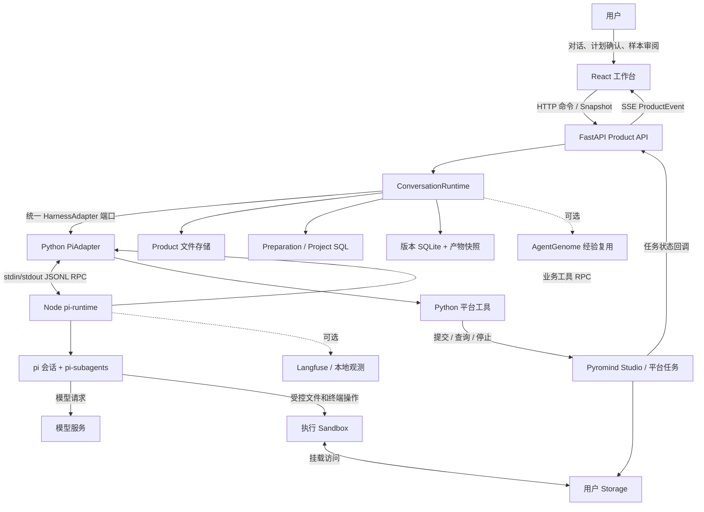
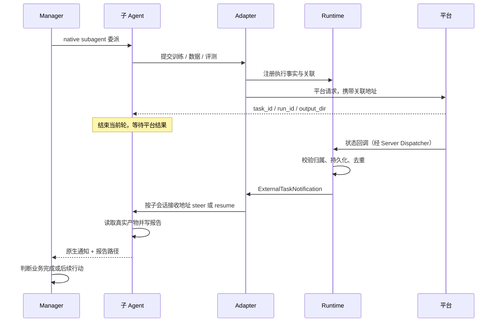

# EchoMind Agent 当前整体技术架构报告

基准日期：2026-11-13
分析对象：本地工作区当前代码，包含未提交修改，不代表线上部署版本。
主要范围：`software-agent-sdk` 和 `minimal-chat-frontend`；平台接口作为外部依赖分析，不把其他参考仓库的能力视为本系统已实现能力。

## 1. 总体结论

EchoMind 当前是一个**以 Manager 为业务决策中心、以 pi 原生子 Agent 为执行单元、以统一 Product Runtime 为事实和治理中心的模型开发工作台**。

当前主链路：

```text
用户对话
  -> 准备信息与可审阅计划
  -> 用户创建并启动 Project
  -> Manager 委派 Init / Dataset / Train / Eval
  -> 子 Agent 提交平台任务后结束本轮
  -> Runtime 接收结果并恢复原子会话
  -> 子 Agent 分析并交付报告
  -> Manager 判断是否继续、调整方向或结束
```

需要避免四种误读：

1. **不是两个产品 Agent 串联。** EchoMind 与 Pyromind 是独立 Profile，共享基础设施，不通过互相调用完成任务。
2. **不是 Runtime 自动遍历 DAG。** 当前 Manager 自行决定下一步，阶段依赖不等于后台自动调度规则。
3. **不是 AgentGenome 驱动所有委派。** 当前 EchoMind 阶段开发依赖原生 `subagent`；经验图复用是另一个可选通用能力。
4. **不是已完成的线上数据飞轮。** Init、Dataset、Train、Eval 已有执行角色；Inference、Tracer 是未实现占位，RawData 也没有独立执行角色。

最重要的状态分工是：

| 状态 | 负责方 | 性质 |
| --- | --- | --- |
| 用户接受的准备计划、Project 身份 | Product Runtime + SQLPreparationStore | 结构化产品状态 |
| 目标是否达成、证据是否充分、下一步方向 | Manager + `workflowPLAN.json` | Agent 的业务判断 |
| 子会话运行、并发、steer、resume、通知 | pi + pi-subagents | Harness 私有执行状态 |
| 平台任务提交、回调、产物、授权 | Product Runtime + 平台 | 可核验的执行事实 |
| 阶段列、运行历史、等待分析等展示 | Snapshot 投影 + 前端 | 事实的派生视图 |

依据：[产品 Profile](../pyromind-agent-server/pyromind_agent_server/profiles.py)、[Manager 契约](../openhands-agent-server/openhands/agent_server/agent_profiles/echomind_manager.py)、[现行工作台说明](echomind-workbench.md)。

## 2. 系统上下文与运行拓扑



这里的 Python 包不是独立微服务。现有代码表现为一个组合式 Python 服务、按需启动的 Node Runner，以及平台 Sandbox / Studio 任务；没有证据表明当前 EchoMind 已拆为独立 Manager、Dataset、Train 等服务。

### 2.1 主要运行单元

| 单元 | 技术与入口 | 职责 |
| --- | --- | --- |
| 测试版前端 | React / TypeScript，`EchoMindChat.tsx` | 展示准备计划、Project、Manager、子 Agent、确认面板 |
| 产品服务 | FastAPI / Uvicorn，`python -m pyromind_agent_server` | HTTP、身份上下文、依赖装配、统一 API |
| 产品运行时 | Python，服务进程内 | 会话、命令、事件、恢复、外部任务、评测和版本用例 |
| Harness 桥接 | Python PiAdapter + Node pi-runtime | 连接统一协议与 pi 会话，隔离原生工具和事件 |
| 子 Agent | pi-subagents 管理的独立子会话 | 执行明确授权的角色任务，保留可续跑上下文 |
| 执行环境 | 平台 Sandbox 或本机 OS Sandbox | 数据探查、脚本、文件操作、DSL 构建 |
| 重型任务 | Studio / 平台计算任务 | 数据批处理、GPU 推理、训练、评分 |

关键点：Node Runner 不等于执行 Sandbox。Agent 控制、模型请求与文件/终端执行是相互桥接的不同执行面。

## 3. 代码分层与职责

```text
minimal-chat-frontend
    |
pyromind-agent-server        HTTP / 鉴权 / Profile / 装配
    |
pyromind-runtime
    +-- domain              统一命令、事件、快照、任务关联、版本模型
    +-- application         ConversationRuntime 与各业务用例
    +-- ports               Harness / Store / Storage / Workflow 等端口
    +-- infrastructure      文件、SQL、SQLite 的实现
    |
harness-adapter              原生会话、工具、事件、恢复、Sandbox 桥接
    +-- harness_adapter/pi_adapter
    +-- pi-runtime          TypeScript，pi 及插件集成
    |
pi / pi-subagents / 通用 Python 平台工具
```

### 3.1 Product Server

`profiles.py` 定义 EchoMind 的独立契约：路由前缀、Profile ID、指令、准备策略、工具与 Skill 白名单、委派角色、允许的产品命令。

`api/router.py` 是共享 Router 工厂，同一套实现分别挂载到产品路由，不复制 EchoMind Runtime：

- EchoMind：`/api/v2/echomind/conversations`。
- Pyromind：`/api/v2/pyromind/conversations`。
- Project 列表和兼容节点 API：`/api/echomind/projects`。

`bootstrap.py` 装配 Adapter、Product Store、Preparation Store、版本服务、平台任务查询、Storage、可选 AgentGenome 和观测组件。

### 3.2 Product Runtime

`ConversationRuntime` 是产品用例入口，主要负责：

- 创建、附着、恢复和回收会话。
- 命令授权、幂等收据与事件持久化。
- 准备计划提交和用户创建 Project。
- 用户问题、权限请求、取消及自动执行暂停。
- 关联外部任务，接收回调，恢复正确的执行接收者。
- DSL 执行请求、版本记录、评测产物与人工复核。
- Snapshot / SSE，及阶段工作台的只读状态投影。

Runtime 通过通用 `HarnessAdapter`、Storage、Workflow 等端口访问外部能力，不直接导入 pi、OpenHands 或 FastAPI。

### 3.3 Harness Adapter

Python `PiAdapter` 实现统一会话接口，并承接业务工具调用、权限检查、Sandbox、会话恢复和原生事件转换。

`PiRunnerProcess` 启动私有 Node 进程，以有版本和帧大小约束的 JSONL RPC 双向通信：

- Python -> Node：启动、消息、取消、通知、策略和会话控制。
- Node -> Python：业务工具、用户提问、准备计划提交及执行环境请求。
- Node -> Python 事件：模型流、工具活动、子 Agent 活动和运行结束。

TypeScript `pi-session.ts` 创建 pi 会话、加载资源和插件；`SubagentHost` 负责宿主能力桥接与观测，子任务生命周期仍交给 pi-subagents。

依据：[Runtime](../pyromind-runtime/pyromind_runtime/application/conversation_runtime.py)、[Harness 端口](../pyromind-runtime/pyromind_runtime/ports/harness.py)、[PiAdapter](../harness-adapter/harness_adapter/pi_adapter/adapter.py)、[Runner](../harness-adapter/harness_adapter/pi_adapter/runner.py)。

## 4. Manager 与四类子 Agent

### 4.1 Manager 的两个权限阶段

| 阶段 | 工具 / Skill | 允许做什么 |
| --- | --- | --- |
| 创建 Project 前 | read、write、edit、terminal、ask_user、set_preparation_plan；`model-evaluation-preparation` | 探查真实数据、补充必要信息、提交可审阅计划 |
| 创建 Project 后 | read、write、edit、terminal、subagent、ask_user、get_storage_url；Manager 不额外挂场景 Skill | 分析报告、维护业务判断、委派并控制子 Agent |

Manager 不直接持有训练、批处理或评测提交工具，重型业务执行通过角色白名单约束下放。

### 4.2 子 Agent 能力矩阵

所有角色均具备受控 read / write / edit / terminal，以下列出主要增量能力：

| 角色 | 职责 | 业务工具 | Skill |
| --- | --- | --- | --- |
| Init | 基模评测、基线结果解读 | df_submit_evaluation、df_check_progress、df_stop_task、get_storage_url | inference-evaluation、avi-baseline-evaluation |
| Dataset | 样本处理、数据清洗、交付下游数据 | df_submit_pipeline、df_check_progress、df_stop_task、get_storage_url | data-processing |
| Train | DSL 生成、验证、训练提交、技术恢复与诊断 | validate_workflow_dsl、submit_workflow、inspect_workflow_task、training_analysis、df_stop_task、get_storage_url | generate-workflow-dsl、workflow-execution、training-analysis |
| Eval | 候选模型推理、评分与结果解读 | 与 Init 相同 | 与 Init 相同 |

EchoMind 创建会话时启用用户输入，PiAdapter 会为委派角色补充 `ask_user`，Node 宿主再提供角色受控的问答工具。Dataset 可据此直接请求样本审阅，其他角色也可询问超出原授权范围的决策；表内仅列业务工具，不含这项动态补充能力。

### 4.3 上下文与委派机制

- Manager 使用 `{agent, task, async:true}` 委派完整任务，以任务文字传递目标、真实输入、约束和预期产物。
- 角色定义关闭全局/项目上下文和 Skill 自动继承；子 Agent 不天然获得 Manager 的完整对话。
- 宿主提供模型调用、受控工具和该角色允许的 Skill，模型不能任意覆盖角色工具、工作目录或模型。
- 当前插件配置最多 4 个活跃异步任务，全局并发上限为 4，嵌套深度为 1。
- 子 Agent 通过宿主代理使用模型，不直接拿到真实模型密钥；模型与 API 参数来自会话配置，不能从用户的模型规划推断当前会话固定使用某个模型。
- `resume` 恢复原子会话上下文，但返回新的 native run ID；展示与回调不能把 run ID 当作稳定会话 ID。
- 子任务文件使用宿主提供的 task workspace，报告交付后 Manager 读取证据并决定下一步。

**边界提醒：** 工具白名单是硬边界；不重复启动、何时重试、什么算业务完成等仍有一部分依赖 Prompt 和 Agent 判断，不等于存在完整业务状态机。

依据：[角色配置](../pyromind-agent-server/pyromind_agent_server/profiles.py)、[角色 Prompt](../harness-adapter/pi-runtime/agents/)、[SubagentHost](../harness-adapter/pi-runtime/src/subagent-host.ts)、[上下文隔离配置](../harness-adapter/pi-runtime/src/subagent-roles.ts)。

## 5. 核心执行链路

### 5.1 准备与创建 Project

1. 前端创建 EchoMind conversation，服务按 Profile 生成 `SessionSpec`，明确选择 `harness_id="pi"`。
2. Manager 读取 Preparation Skill，探查数据；无法查明但影响执行的信息通过 `ask_user` 收集。
3. `set_preparation_plan(plan, entry_task_id)` 进入 Runtime。校验节点目录、任务类型、可执行入口、真实资源路径及 revision。
4. SQL Store 保存准备状态。用户继续发言会使审阅上下文失效，避免旧计划被误确认。
5. 用户点击“创建并启动”，前端提交 `create_project` 和 `expected_preparation_revision`。
6. Runtime 检查准备状态、待回答问题与权限请求、cluster；激活 Project 并切换开发工具策略。
7. Runtime 通知 Manager：把接受的计划写入 `public_data/workflowPLAN.json`，再通过原生 subagent 启动入口任务。

这里不是“点击按钮后 Runtime 直接运行所有阶段”。创建命令完成也不等于入口任务已交付，后续仍依赖通知送达和 Manager 执行。

### 5.2 平台任务与子会话恢复



统一 `TaskCorrelation` 包含 conversation、main/subagent 接收者、稳定 subagent_id、task_kind。平台通过 `out_id` 携带关联，Runtime 不需要知道插件的原生 session 文件位置。

Adapter 内部再把稳定接收地址映射回 native run：仍运行则 steer，已完成则 resume。Runtime 对重复回调、先到回调、未激活会话、投递失败及取消后的暂停策略分别处理，并有平台状态查询补偿。

**这是可恢复、可去重的应用级通知机制，不应宣称跨所有平台副作用实现了端到端 exactly-once。**

### 5.3 取消与等待的语义

- 子 Agent 本轮结束，不表示平台任务完成。
- 平台成功，不表示报告已交付，更不表示业务目标达成。
- native stop 不会自动取消远程平台任务；需要平台 stop 工具或产品会话取消链处理。
- 取消后 Runtime 的持久化自动执行暂停策略会阻止新自动轮次；回调仍可保存事实。
- 展示区分 waiting_platform、waiting_analysis、analyzing、reported 等状态。

依据：[Preparation 用例](../pyromind-runtime/pyromind_runtime/application/preparation.py)、[关联模型](../pyromind-runtime/pyromind_runtime/domain/task_correlation.py)、[状态 Dispatcher](../pyromind-agent-server/pyromind_agent_server/workflow_status_dispatcher.py)、[子会话接收者](../harness-adapter/pi-runtime/src/subagent-recipients.ts)。

## 6. 工作流、评测与经验复用

### 6.1 三种“工作流”不能混为一谈

| 名称 | 当前作用 | 是否直接执行 |
| --- | --- | --- |
| workflowPLAN / preparation plan | 业务目标、阶段、任务和依赖；创建后 Manager 记录判断 | 文件修改本身不启动任务 |
| Python DSL `workflow.py` | Studio 计算工作流，Train 等角色生成并验证 | 通过提交工具执行 |
| AgentGenome graph / script | 历史经验沉淀、复用和通用工作流运行 | 在对应能力启用和调用时执行 |

主工作台不是画布编辑器。Train 在 task workspace 写入 `workflow_canvas/workflow.py`，验证与提交必须使用该实际文件路径。

### 6.2 评测能力

评测支持真实推理与确定性评分，也支持复用已有预测评分；业务评分脚本在 CPU Worker 执行，Runtime 不直接执行生成的评分代码。

训练评测链会核对冻结 manifest、评分规则和脚本摘要，保存 step 级评测、checkpoint 选择、iteration context 与报告。选择逻辑要求验证集、可比组、有效指标及同 step 的完整 checkpoint；baseline 和 test 不参与候选选择。

Runtime 另有评测 case、媒体、annotation、review task 和导出用例；这些是通用评测基础设施，不表示 EchoMind 已自动调用全部人工标注或线上部署功能。

### 6.3 版本与实验血缘

版本体系记录 `VersionProject -> VersionRun -> ArtifactVersion`，覆盖数据、代码、DSL、模型、评测、报告等。

本地未提交代码已包含：

- `experiments.py` 只读实验目录与指标投影。
- `/experiments`、`/experiments/{id}`、`/experiment-metrics`。
- `lineage.py` CLI，经同一授权 API 查询。

实验展示以 workflow run 为锚点，通过来源 task、模型路径及 selection 证据关联评分/推理；证据不足的评测保留为 unassigned，不凭时间相邻猜测归属。趋势指标只来自成功、eligible 且有 comparison_group 的评测。

`reference_only` 产物是引用，不是完整不可变快照；运行归档也受 `PYROMIND_RUN_ARCHIVES_ENABLED` 控制，默认不启用。当前前端没有看到实验目录和指标趋势的完整消费界面，因此应区分“后端查询已实现”和“工作台已产品化展示”。

### 6.4 AgentGenome 的实际位置

`PYROMIND_AGENTGENOME_ENABLED` 控制通用经验能力；bootstrap 在默认 backend 为 pi 时装配 AgentGenomeBackend，通过 Adapter 的执行宿主访问 pi。

当前启动脚本启用它，但 EchoMind Manager 的开发工具白名单没有经验管理工具。因此“服务具备经验能力”不等于“EchoMind 阶段已自动经验沉淀和复用”。

用户级 registry 默认位于挂载 Storage 的 `.pyromind-agent/agentgenome`，可由 `AGENTGENOME_HOME` 覆盖。它不应被误认为会话产品状态或阶段调度数据库。

依据：[版本模型](../pyromind-runtime/pyromind_runtime/domain/versions.py)、[训练评测](../pyromind-runtime/pyromind_runtime/application/training_evaluations.py)、[Checkpoint 选择](../pyromind-runtime/pyromind_runtime/application/checkpoint_selection.py)、[实验投影](../pyromind-runtime/pyromind_runtime/application/experiments.py)、[经验桥接](../harness-adapter/harness_adapter/agentgenome_bridge.py)。

## 7. 持久化与恢复

| 存储 | 内容 | 恢复意义 |
| --- | --- | --- |
| `<conversation>/product/` | meta.json、events.jsonl、commands.jsonl、snapshot.json，以及执行记录 | 产品授权、命令去重、事件重放、快照恢复 |
| SQLPreparationStore | experiment_preparations、experiment_projects | 准备 revision、接受的计划、Project 身份、cluster 和 Profile |
| ProjectStore 文件 | 项目记录与 graph.json | Project 列表及兼容接口读取 |
| `<conversation>/pi/` | 原生 session、inflight、权限、完成记录、子会话和展示资料 | Runner 重启、续跑、原生接收者恢复 |
| 版本 SQLite | 版本项目、run、产物、父子关系 | 复现、对比与血缘查询 |
| 用户 Storage / task workspace | 数据、脚本、workflowPLAN、DSL、报告、模型及评测产物 | 真正的业务文件和计算输入输出 |
| External Task Registry | 平台 task 与 conversation、origin 关联 | 外部任务回调路由、重连和查询补偿 |

Preparation DB 支持 MariaDB 和持久化 SQLite。当前 `start_inference.sh` 默认 MariaDB；未配置 Preparation Store 时，EchoMind 创建会话会返回不可用错误，而不是静默降级为纯聊天。

Product Store 有文件锁、原子快照写入和事件序号，能从事件日志重建快照。SSE 可从 afterSeq / Last-Event-ID 重放；前端检测序号缺口后重新获取 Snapshot。

会话资源采用活跃、释放和保留期回收分层策略。bootstrap 默认产品空闲回收 300 秒、释放宽限 300 秒、Sandbox 保留 1800 秒；实际时机受活动状态、外部任务、订阅及环境配置影响，不是所有任务到点无条件删除。

**一致性边界：** SQL Project、ProjectStore 文件、Product 日志、pi session 和 Storage 并非同一事务。代码有幂等、revision 与补偿，但需要按故障点验证，不能把“单个存储原子写入”扩展为“全链路原子事务”。

## 8. 前端与公开协议

`EchoMindChat` 仅选择 EchoMind client、标题和独立存储命名空间，主工作台复用 `ProductPlanningChat`。

主要界面：

- Project 与 conversation 导航，携带并恢复 Project cluster。
- 准备对话、结构化计划预览、创建按钮。
- Manager 对话。
- StageWorkspace 阶段列、运行历史、续跑记录和子 Agent 活动。
- ProjectConfirmationPanel 用户问题和权限确认。

通信采用 **HTTP + Snapshot + SSE**，不是直接订阅 pi 原生事件，也不是前端控制子 Agent 调度。旧前端仍保留其他聊天链路，不能据此把 EchoMind 的现行传输认定为 WebSocket。

服务侧先把 pi 事件转换为中性 HarnessEvent，再投影为 ProductEvent；`history.synced`、`workflow.modified`、`run.finished` 等内部事件不会原样进入公开产品事件类型。

前端独立命名空间是 `minimal-chat.echomind.v2`；服务侧 Profile、用户归属和会话目录共同构成隔离，不能只依赖 URL 或 localStorage。

依据：[EchoMind 入口](../../minimal-chat-frontend/src/EchoMindChat.tsx)、[共享工作台](../../minimal-chat-frontend/src/components/ProductPlanningChat.tsx)、[阶段展示](../../minimal-chat-frontend/src/components/StageWorkspace.tsx)、[SSE Hook](../../minimal-chat-frontend/src/hooks/useProductEventStream.ts)、[事件投影](../pyromind-runtime/pyromind_runtime/application/event_projection.py)。

## 9. 隔离、安全与架构符合度

### 9.1 已明确落实的机制

- EchoMind 有独立 Profile ID、路由和本地存储空间；Product Store 按 user_id + profile_id 授权。
- 准备 / 开发工具策略和子角色白名单由宿主配置，不接受模型任意扩大。
- 子会话路径与身份检查限制跨 conversation 访问；回调关联验证 task、conversation 和 origin 一致性。
- RequestContext 传递 Cookie、Authorization、cluster，持久化模型拒绝凭据字段或不稳定 URL。
- 平台 Sandbox 与 OS Sandbox 均有受控工作区和权限接口；子 Agent 不能将 native 参数作为任意覆盖入口。
- 有包依赖、Profile 隔离、回调归属、取消暂停、恢复和只读投影测试。

以上是已观察到的防护机制，不构成对所有脚本、任意文件内容和观测日志的完整安全审计。

### 9.2 与目标架构仍有距离

| 现状 | 判断与影响 |
| --- | --- |
| `pyromind_agent_server.app` 仍调用旧 `create_openhands_app` | pi 已是 EchoMind 执行底座，但服务壳、配置、身份和 ConversationService 尚未完全独立 |
| bootstrap 同时注册 OpenHandsAdapter / PiAdapter，代码默认 backend 仍是 openhands | 启动脚本与 EchoMind Profile 的选择不能替代清理代码默认值；新部署路径需要核对配置 |
| Profile 与 Project 模块仍放在 `openhands.agent_server` 命名空间 | 不是 EchoMind 实际运行 OpenHands 的证据，但产品代码归属与目标分层尚不整齐 |
| `/api/echomind/projects` 兼容路由直接访问 ProjectStore / StageRun | 仍有统一 Runtime 入口以外的产品 API，用“所有路由均只调用 Runtime”描述现状不准确 |
| init / dataset / train / eval 的 EchoMind Prompt 打包在 Adapter 内 | Profile 通过角色名称选择，但场景契约物理存放于 Harness 下层；新增 Harness 的角色定义复用边界应明确 |

这里区分“命名遗留”“服务装配兼容”与“真正的 Harness 专属行为泄漏”，不能仅凭 `openhands.*` 名称断言旧 Harness 仍在主链路运行。

## 10. 当前主要限制与建议

### 10.1 优先处理：计划与视图的一致性

**观察事实：** SQL Project View 来自创建时接受的 preparation plan；Manager 后续修改的是普通 `workflowPLAN.json`。当前 `get_snapshot` 没有读取该文件并同步更新 Project.plan。

**影响判断：** Manager 的最新业务判断与工作台阶段结构可能不同步。不能声称普通文件已是前端所有结构化视图的实时唯一真相源。

**建议：** 明确二者契约。若文件是业务判断记录，UI 显式呈现它而不冒充平台事实；若要编辑阶段拓扑，应设计通用、可校验且有 revision 的更新入口。

### 10.2 优先处理：同角色多阶段的归属

**观察事实：** `project_stage_activity` 按 operation.name 对应角色，在计划里查找阶段，只有唯一候选才绑定。节点目录除 Init 外允许多实例。

**影响判断：** 两个 Dataset 或 Train 阶段共享同一角色时，仅凭角色名无法可靠归列，可能缺少阶段展示，而不一定影响底层任务运行。

**建议：** 在不把产品编排塞回 Harness 的前提下，提供宿主可信的通用任务关联；不要用 Prompt 猜阶段或按时间邻近绑定。

### 10.3 工程治理：压缩兼容面

现行代码仍公开旧节点 start/run/runs/artifacts API。当前工作台主要消费 Project 列表及统一对话能力，不应让旧节点链路继续扩展为第二套调度器。

建议列出实际使用方、兼容期限和迁移路径，逐步把 Profile、Project 等产品模块从旧服务命名空间迁出，保持公开协议兼容。

### 10.4 生产化：多实例与恢复验收

Runtime 的活跃会话、订阅、锁和通知重试有进程内状态，产品事件和部分索引在文件存储。代码不能直接证明多副本随机路由能无损协作。

建议在扩容前明确会话粘性、存储挂载、回调路由、单会话执行所有权与跨进程事件分发；补充“提交成功但收据未落盘”“数据库提交后通知失败”“Runner 丢失时回调到达”等故障验收。

### 10.5 产品能力：开发闭环与线上闭环分开验收

当前可以描述为“模型开发与评测迭代工作台”。线上部署、持续采集、自动回流与发布治理仍需独立设计和实现。

建议先稳定 Init -> Dataset -> Train -> Eval 的真实产物、可比指标和人工决策，再接入 Inference / Tracer；不要把占位节点或平台已有服务等同于 EchoMind 已编排完成。

## 11. 验证范围

本报告基于入口、Profile、Runtime、Adapter、原生子会话桥接、前端、持久化与架构测试交叉核对；不是仅复述设计文档。

本次执行的验证命令：

```sh
uv run pytest tests/pyromind_runtime -q
```

结果：**758 passed，6 skipped，1 warning，54.74 秒**。warning 为 FastAPI / Starlette 的 HTTP 422 常量弃用提醒。跳过项包括现场用户输入测试和部分数据库测试，不代表这些环境已被验证。

文档执行了 `uv run pre-commit run --files docs/echomind-current-architecture-2026-11-13.md`；当前 hooks 对 Markdown 没有适用检查，均跳过。未进行真实平台训练、推理提交或浏览器端到端验收；不能由单元测试推导线上可用性。

未提交的实验血缘实现已经计入本报告，但不推断它已合并或已发布。

## 12. 推荐阅读顺序

1. [Profile](../pyromind-agent-server/pyromind_agent_server/profiles.py)：了解 Manager 和角色可做什么。
2. [Manager Prompt](../openhands-agent-server/openhands/agent_server/agent_profiles/echomind_manager.py)：了解谁做业务决策。
3. [ConversationRuntime](../pyromind-runtime/pyromind_runtime/application/conversation_runtime.py)：了解产品命令、事实和恢复。
4. [HarnessAdapter](../pyromind-runtime/pyromind_runtime/ports/harness.py)：了解可替换执行底座的边界。
5. [pi-session](../harness-adapter/pi-runtime/src/pi-session.ts) 与 [SubagentHost](../harness-adapter/pi-runtime/src/subagent-host.ts)：了解原生委派与宿主桥接。
6. [Snapshot 投影](../pyromind-runtime/pyromind_runtime/application/snapshot_projector.py)：了解阶段显示为什么不等于调度。
7. [工作台组件](../../minimal-chat-frontend/src/components/ProductPlanningChat.tsx)：了解实际用户流程。
