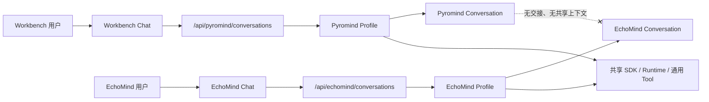

# EchoMind 双 Agent 架构改动设计

> 状态：已落地  
> 日期：2026-10-29  
> 范围：Pyromind Agent 与 EchoMind Agent 的拆分、隔离、共享底座和扩展方式  
> 不在本文范围：EchoMind 的 Project/Graph 生命周期设计

## 1. 改动摘要

本次改动把原来的单一 Agent 入口拆成两个完全独立、对外接口不同的 Agent：

| Agent | 对外入口 | 继续使用原入口的客户端 |
|---|---|---|
| Pyromind Agent | `/api/pyromind/conversations` | 原 Workbench Chat |
| EchoMind Agent | `/api/echomind/conversations` | 新的 EchoMind Chat |

“两个 Agent”准确指两个服务端固定的 **Agent Profile / 执行契约**，不是两套 SDK、
两套 Agent Runtime 或两套 Tool 框架。两个 Agent 共享底层运行时和通用能力实现，
但拥有独立的：

- Chat API
- System Prompt
- Skill 白名单
- Tool 白名单
- Conversation 标签
- 前端状态与本地会话记录
- 用户可见的职责边界

两个 Agent 之间没有交接、没有互相调用、没有共享会话上下文。一个 Agent 不会因为
另一个 Agent 的存在而读取或继承其对话内容。

## 2. 设计目标

1. 原有 Pyromind Agent 的接口、会话和行为保持兼容。
2. EchoMind Agent 可以独立创建会话、列会话、恢复历史和发送消息。
3. 两个 Agent 在 API、Prompt、上下文和会话层面完全隔离。
4. 通用 Skill、Tool、SDK 和前端基础组件继续复用，避免复制基础设施。
5. 后续新增场景时，只新增场景 Skill 和必要的 Profile 配置，不向通用 Tool 中加入
   场景分支。
6. 每个阶段都能单独启动和验证，避免一次性改造过大。

## 3. 非目标

- 不建立两个 Agent 之间的消息转发、任务委派或上下文交接。
- 不新增第三个 Manager Agent。
- 不让 EchoMind Agent 接管 Pyromind Agent 的会话。
- 不复制一套 Agent Runtime、Tool 实现或前端聊天组件。
- 不在通用 Skill/Tool 内判断调用方是哪个 Agent。
- 不在本次改动中定义生产态调度协议。

## 4. 总体架构



关键原则：

> 共享的是能力实现，不共享的是 Agent 契约和会话上下文。

## 5. 两个 Agent 的职责

| 维度 | Pyromind Agent | EchoMind Agent |
|---|---|---|
| 产品定位 | 原工作台开发 Agent | 训练与实验场景入口 Agent |
| 入口 | `/api/pyromind/conversations` | `/api/echomind/conversations` |
| System Prompt | 原 Pyromind 工作台契约 | EchoMind 独立契约 |
| Profile tag | `pyromind` | `echomind` |
| LLM usage id | `pyromind-agent` | `echomind-agent` |
| Skill 白名单 | 原有开发 Skill | 原有开发 Skill + `avi-single-turn` |
| Tool 白名单 | 完整平台开发工具 | 与 Pyromind 当前完整工具集一致 |
| 会话列表 | 原 Pyromind/Workbench 列表 | EchoMind-only 列表 |
| 前端入口 | Workbench Chat | `?chat=echomind` |
| 与另一 Agent 的关系 | 不读取 EchoMind 会话 | 不读取 Pyromind 会话 |

Workbench Chat 是前端页面名称，不是第三个 Agent。

## 6. Profile 是唯一的能力装配清单

服务端通过 `AgentProfileSpec` 描述一个 Agent 的固定契约：

```python
@dataclass(frozen=True, slots=True)
class AgentProfileSpec:
    name: str
    tag_value: str
    usage_id: str
    system_prompt: str | None
    skill_allowlist: tuple[str, ...]
    tool_allowlist: tuple[str, ...]
```

当前有两个显式清单：

- `PYROMIND_PROFILE`
- `ECHOMIND_PROFILE`

设计意图是把一个 Agent 的差异集中到一份可检查的配置里，而不是散落在 Router、
Tool 实现和 Prompt 字符串中。

### 6.1 Prompt 差异

EchoMind Agent 使用独立 System Prompt，明确：

- 识别用户场景并选择匹配 Skill
- 先澄清需求，再形成可确认的创建请求
- 不伪造服务端 ID
- 不成为生产态调度器
- 不读取或操作 Pyromind Agent 会话
- 不把内部 Prompt、Tool 名称或协议直接暴露给用户

### 6.2 Skill 差异

EchoMind Agent 当前 Skill 白名单：

```text
avi-single-turn
generate-workflow-dsl
debug-workflow
data-processing
sandbox
training-analysis
label-studio
```

Pyromind Agent 使用同一组通用开发 Skill，但不包含 `avi-single-turn`。

`avi-single-turn` 是 EchoMind 的场景配方，负责 AVI 场景的需求澄清和场景资源引用。
它不负责修改通用 Tool，也不要求平台通用能力感知 AVI 业务。

### 6.3 Tool 差异

当前两个 Profile 的 Tool 白名单完全一致。EchoMind Agent 保留原 Agent 的完整平台
开发能力，包括：

- 文件、终端和 Skill 工具
- Workflow 生成、校验、调试和提交工具
- Sandbox 创建、终端、文件读写和删除工具
- Storage 与数据处理工具
- 训练分析、失败诊断和 Label Studio 工具

当前选择“Tool 白名单一致”是有意的：

- 两个 Agent 的差别首先是产品契约和上下文，不是能力是否可用。
- EchoMind Agent 仍需执行开发期调试和远端 Sandbox 验证。
- Tool 行为必须保持通用；如果未来确实需要不同行为，应新增通用 Tool 能力，
  而不是在旧 Tool 内按 Agent 名称分支。

Tool 白名单在 Agent 构建完成后统一过滤：

```python
allowed_tools = set(profile.tool_allowlist)
tools = [tool for tool in agent.tools if tool.name in allowed_tools]
agent = agent.model_copy(update={"tools": tools})
```

## 7. 服务端构建与路由

两个 Router 独立注册：

```text
api_router.include_router(pyromind_router)
api_router.include_router(echomind_router)
```

### 7.1 Pyromind 入口

```text
POST /api/pyromind/conversations
POST /api/pyromind/conversations/{conversation_id}/messages
```

### 7.2 EchoMind 会话入口

```text
POST /api/echomind/conversations
GET  /api/echomind/conversations
GET  /api/echomind/conversations/{conversation_id}
GET  /api/echomind/conversations/{conversation_id}/messages
POST /api/echomind/conversations/{conversation_id}/messages
```

EchoMind 客户端不需要调用 Pyromind 的 Chat 接口来列会话、恢复历史或发送消息。

### 7.3 共用构建函数，不共用执行契约

两个入口可以复用底层 Agent 构建函数，但必须传入自己的 Profile：

```python
agent, secrets = _build_agent_with_profile(
    http_request,
    request=request,
    profile=PYROMIND_PROFILE,
    ...
)
```

```python
agent, secrets = _build_agent_with_profile(
    http_request,
    request=request,
    profile=ECHOMIND_PROFILE,
    ...
)
```

共享构建函数只负责装配通用能力，不负责让两个 Agent 共享上下文。

## 8. Conversation 隔离

每个 Conversation 在创建时写入 Profile 标签：

```json
{
  "app": "pyromind",
  "agentprofile": "echomind"
}
```

服务端在每个受限入口校验该标签：

- Pyromind 消息接口只接受 Pyromind/legacy Workbench 会话。
- EchoMind 会话、消息和历史接口只接受 `echomind` 会话。
- 跨 Profile 请求返回 `404`，不暴露另一个 Agent 的会话是否存在。

隔离规则：

1. 不共享 `conversation_id`。
2. 不共享事件流。
3. 不共享 conversation workspace。
4. 不共享后台任务上下文。
5. 不把一个 Agent 的对话摘要注入另一个 Agent。
6. 不允许一个 Profile 的消息 API 操作另一个 Profile 的会话。

## 9. 前端设计

前端共享展示组件，例如消息气泡、Tool 调用卡片、事件流 Hook 和状态栏；但不共享
Agent 会话状态。

### 9.1 原 Workbench Chat

- 继续使用 Pyromind Chat API。
- 原会话列表、工作流画布和调试交互保持不变。
- 不读取 EchoMind 本地会话 key。

### 9.2 EchoMind Chat

- 独立页面入口：`/?chat=echomind&userId=<debug-user-id>`
- 独立 API 客户端和契约模块。
- 独立 EchoMind-only 会话列表。
- 会话 ID 按用户持久化。
- 刷新后恢复当前 EchoMind 会话、历史事件和对应业务状态。
- 左侧会话列表显示标题、状态、短 ID 和更新时间。
- “New”只切换到新会话状态，不删除旧会话。

共享 UI 组件不等于共享会话状态。两个页面的 conversation id、事件数组和本地存储
key 必须分开。

## 10. 扩展方式

新增一个 EchoMind 场景时，推荐顺序：

1. 新增场景 Skill，例如 `.agents/skills/<scenario>/SKILL.md`。
2. 在 EchoMind Profile 的 `skill_allowlist` 中登记该 Skill。
3. 在 Prompt 或 Skill 中定义场景澄清项和业务边界。
4. 优先复用现有通用 Tool。
5. 只有通用能力确实缺失时，才新增通用 Tool。
6. 不修改 Pyromind Profile 的场景白名单。

禁止模式：

```python
# 不推荐
if agent_profile == "echomind" and scenario == "avi":
    return avi_special_case()
```

推荐模式：

```text
通用 Tool 接收标准输入，产生标准输出
场景差异由 Skill、Profile 白名单和 Prompt 承担
```

## 11. 兼容性

- 原 `/api/pyromind/conversations` 接口继续存在。
- 原 Workbench Chat 的会话和历史不受 EchoMind 改动影响。
- Pyromind Profile 兼容历史会话：没有 Profile 标签或标签为 `workbench` 的旧会话
  仍视为 Pyromind 会话。
- EchoMind 会话不会进入 Pyromind 会话列表。
- EchoMind 消息接口不会接受 Pyromind 会话。
- 当前测试明确约束两个 Profile 的 Tool 白名单一致，EchoMind 只额外获得场景 Skill。

## 12. 风险与控制

| 风险 | 控制措施 |
|---|---|
| 两个入口复制过多路由代码 | 复用底层构建/服务函数；保留独立对外契约 |
| 共用 Tool 被写入 Agent/场景分支 | Code Review 明确禁止；差异放在 Profile/Skill |
| EchoMind 改动污染原 Agent | 独立 Router、Profile、Prompt、Conversation tag 和测试 |
| 前端共享状态导致串会话 | 独立 API、存储 key 和 EchoMind-only 会话列表 |
| 新增场景导致核心 Skill 膨胀 | 一个场景一个 Skill，通过 Profile 装配 |
| Profile 清单与实际加载不一致 | 测试校验 Skill/Tool allowlist 和会话隔离 |

## 13. 验证标准

### 架构

- 两个 Agent 使用不同 API 入口。
- 两个 Agent 使用不同 System Prompt 和 Profile tag。
- 两个 Agent 的 Conversation 不互相出现在对方列表中。

### 隔离

- EchoMind 消息接口拒绝 Pyromind 会话。
- Pyromind 消息接口拒绝 EchoMind 会话。
- 跨 Profile 请求返回 `404`。
- 一个 Agent 的对话内容不会进入另一个 Agent 的系统上下文。

### 能力

- EchoMind Agent 可以使用完整平台开发 Tool。
- EchoMind Agent 额外加载场景 Skill。
- Sandbox 工具在 EchoMind Profile 中可用。
- 通用 Tool 不包含 EchoMind 或场景专属分支。

### 回归

- 原 Pyromind Chat 创建、消息、事件流和工作流能力不变。
- 前端两个入口分别构建、启动和刷新恢复。
- EchoMind 会话列表只显示 EchoMind 会话。

## 14. 渐进式实施

| 阶段 | 内容 | 独立验证 |
|---|---|---|
| P0-1 | 抽取 `AgentProfileSpec` 和两个 Profile 清单 | Profile 加载、Skill/Tool 白名单 |
| P0-2 | 新增 EchoMind Router 和 Conversation tag | 创建会话、跨 Profile 404 |
| P0-3 | 新增 EchoMind 会话列表、详情和历史接口 | 列表隔离、刷新恢复 |
| P0-4 | 前端新增 EchoMind API 客户端和独立入口 | 创建、发送、切换、刷新 |
| P0-5 | 加入首个场景 Skill | Skill 选择、需求澄清、场景资源 |
| P1 | 按场景逐步补齐可执行能力 | 每个阶段独立启动验证 |

## 15. 代码索引

| 责任 | 文件 |
|---|---|
| Profile 契约 | `openhands-agent-server/openhands/agent_server/agent_profiles/spec.py` |
| Pyromind Profile | `openhands-agent-server/openhands/agent_server/agent_profiles/pyromind.py` |
| EchoMind Profile | `openhands-agent-server/openhands/agent_server/agent_profiles/echomind.py` |
| 共用 Agent 构建 | `openhands-agent-server/openhands/agent_server/pyromind_router.py` |
| Pyromind Router | `openhands-agent-server/openhands/agent_server/pyromind_router.py` |
| EchoMind Router | `openhands-agent-server/openhands/agent_server/echomind_router.py` |
| Router 注册 | `openhands-agent-server/openhands/agent_server/api.py` |
| EchoMind 前端 | `minimal-chat-frontend/src/EchoMindChat.tsx` |
| EchoMind API 契约 | `minimal-chat-frontend/src/echomindContract.ts` |
| 双 Agent 测试 | `tests/agent_server/test_echomind_router.py` |

## 16. 结论

本次改动的核心不是复制出第二个 Agent Runtime，而是把 Agent 的产品职责提升为服务端
可配置、可校验的执行契约：

- 两个 Agent 独立进出，不交接上下文。
- 通用能力继续复用，避免基础设施重复。
- 场景差异进入 Skill 和 Profile，不进入通用 Tool。
- 原 Pyromind Agent 保持兼容，EchoMind Agent 可以独立演进。

后续新增场景时，应继续遵循：

> 新场景优先增加 Skill，不改造共享 Tool；两个 Agent 可以共享能力，但不能共享会话。
