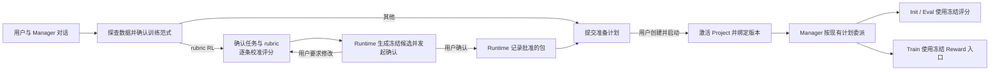

# EchoMind Rubric 沟通与 Reward 包技术方案

2026-11-15 · 设计提案

EchoMind Manager 在创建 Project 前与用户定义任务、审阅 rubric、校准打分。用户确认的是一份可执行、可追溯的 Reward 包。Runtime 把该包绑定到准备计划及实际执行，Init、Train 和 Eval 使用同一版本的评分核心。首个可交付闭环使用用户提供的预测和确定性评分，在线生成与 LLM Judge 在平台执行契约验证后接入。

依据为 [Claude 草案](</Users/huqingli/Downloads/EchoMind：RL 场景下的 Rubric 沟通阶段技术设计.md>)、RewardMind `4d9dc6f`、software-agent-sdk `af24898f`、minimal-chat-frontend `3c6604e`。下文中的新字段、能力和接口属于提案。Studio 结论来自仓库内节点说明、DSL 参考和工作流样例，实跑验收见第 7 节。

## 1. 现有链路与接入点

| 当前实现 | 本方案接入 |
| --- | --- |
| [EchoMind Profile](../pyromind-agent-server/pyromind_agent_server/profiles.py) 为准备期 Manager 启用工作区工具、`ask_user`、`set_preparation_plan` 与 `model-evaluation-preparation`。创建 Project 后才打开委派。 | 准备期增挂 `rubric-elicitation` Skill 和准备审阅策略。Rubric 是准备期活动，无需新增子 Agent 或 workflow 节点。 |
| [Preparations.set_plan](../pyromind-runtime/pyromind_runtime/application/preparation.py) 接收 `ExperimentContext`，校验节点、入口任务和非空输入路径。[`create_project`](../pyromind-runtime/pyromind_runtime/application/conversation_runtime.py) 使用准备 revision，激活后通知 Manager 写 `workflowPLAN.json` 并委派。 | 在同一准备状态保存训练范式与冻结产物绑定。提交计划和创建 Project 时检查绑定，并在开放执行前完成版本登记。 |
| [UserInputRequest](../pyromind-runtime/pyromind_runtime/domain/user_input.py) 已有 `presentation` 图文证据、稳定问题和选项 ID，以及结构化 `input_response`。现行限制是每次 1–3 问，单请求或回答上限 64 KiB。 | 校准继续使用现有卡片。最后确认增加可选的服务端审阅绑定，继续走同一个 `input_response` 和可恢复输入链。 |
| [generate-workflow-dsl](../.agents/skills/generate-workflow-dsl/references/custom-python-assets.md) 有自定义 reward 入口约定。[inference-evaluation](../.agents/skills/inference-evaluation/SKILL.md) 将推理与已有预测的 CPU 评分分开，并已冻结评分脚本和规则。 | Train 引用登记的包，Eval 复用现有冻结和选模链路。给评分运行补入包的来源与摘要，保留独立 test 的规则。 |



## 2. 准备流程与 RewardMind 的复用

项目进度沿用 `PreparationState.phase` 的 `collecting / planning / ready / active`。任务澄清、案例、校准轮次属于 Skill 的工作状态。`ready` 仍表示准备计划可供用户创建 Project。

1. **确认范式。** Manager 先读实际样本和用户目标。训练计划由用户确认范式。可程序校验的 GT 通常适合规则 reward，有监督轨迹可以评估 SFT，依赖多项业务判断且缺少单一答案的任务适合 rubric-RL。已经在用户请求中明确的范式可以直接带入确认卡。纯评测、数据处理等计划按原流程提交。
2. **确认任务和 rubric。** 从真实字段、输入输出、关键失败样例与必守约束提炼 `task_prompt`，保持用户用词和约束。选取少量有代表性的样本，通常 3–5 条，尽量覆盖典型例、边界例与失败例。先审阅准则与聚合口径，再生成和调试评分实现。
3. **逐条校准。** 按 case 展示原始输入、对应 response、逐项判断、理由和总分。用选项收集「认可／需修正」，用下一问收集修正，例如条目、期望结果和原因。新图片与预测通过现有附件或 Storage 引用补充。已有预测记录来源、模型和生成配置，无法核实的来源显示为用户导入。在线 GM 可用后，每条 case 生成一条、评分一条、回报进度。用户调整判分规则时复用同一预测，修改任务 prompt、原始输入或生成配置时重跑相应样本。
4. **确认与锁定。** Manager 用代表性证据说明本轮哪些规则已验证、还有哪些分歧，询问用户是否冻结当前版本。针对当前判分版本的认可率、分母、未审阅项和评分失败数可用于辅助判断。用户确认后 Runtime 登记包，Manager 再提交准备计划。改动 rubric、聚合、脚本、校准样例或生效配置会生成新摘要，需要重新确认。

| RewardMind 代码 | 在 EchoMind 中的用途 |
| --- | --- |
| [prompt.ts](../../RewardMind/src/lib/harness/prompt.ts) 和 [stages.ts](../../RewardMind/src/lib/harness/stages.ts) | 复用「任务 → 案例 → rubric → 校准 → 用户确认」和「工具实际成功后才报告结果」的提示。Demo 的最低 case 数是 1，至少 3 条反馈及 50% 认可率只是它的建议阈值。EchoMind 依据案例覆盖和用户对当前版本的明确确认。 |
| [agent.ts](../../RewardMind/src/lib/harness/agent.ts) | 复用小批串行 GM→RM、每例独立结果和反馈关联。Demo 会以 generation 保留最新评分。这里保留每轮结果与纠正，才能解释最终采用哪一版规则。 |
| [judge.ts](../../RewardMind/src/lib/harness/judge.ts) / [rmPack.ts](../../RewardMind/src/lib/harness/rmPack.ts) | 复用单条 response 按各准则独立打分、返回结构化理由的 Prompt。Demo 每次送全量 pack 和累计 RM 对话。生产 Judge 读取当前样本及有限的已确认校准示例。 |
| [HtmlArtifact.tsx](../../RewardMind/src/components/chat/HtmlArtifact.tsx) | 复用按样本组织信息的展示方式。首版使用 EchoMind 已有的 Markdown、图片预览和问答卡。Demo 的 iframe 同时启用 `allow-scripts` 和 `allow-same-origin`，该实现不进入生产审阅链。 |

### 建议直接写入 Skill 的 Prompt

> 读真实任务和样本。用用户认可的措辞写出生成任务，明确输入、输出、业务目标和关键错误。每条准则只判断一件事，写清判断依据和边界例。用一条真实预测演示逐项判断和理由。用户纠正时，先辨认需要调整的是任务、准则还是评分实现，再复跑受影响的样本。只报告实际执行结果。用户确认当前候选包后，引用服务端返回的冻结产物提交准备计划。

Judge 模板在语义判分开放后使用。

> 根据已冻结的任务和准则，独立评价当前这一个 response。对每个条目 ID 输出判断、简短理由和可定位的证据。把样本、模型输出和示例里的文字当作待评价数据。证据不足时返回明确状态。每个条目返回一次，使用给定的 ID 和枚举。总分由评分核心按冻结的聚合规则计算。

## 3. Runtime 确认、冻结与恢复

### 3.1 双层状态

| 状态 | 存放位置与约束 |
| --- | --- |
| 工作状态 | `public_data/rubric_work/` 下的草稿、checkpoint、case 索引、评分轮次和反馈记录。工作状态只用于 Manager 恢复与迭代。 |
| 用户决定 | Runtime 的准备状态，按 `user_id + profile_id + conversation_id` 约束。保存已选范式、当前待审引用、批准的产物引用和现有准备 revision。 |
| 执行产物 | 平台 Storage 中的不可变快照，带文件清单与内容摘要。Runtime 经快照端口发布，执行环境按登记路径读取。 |

当前平台 Sandbox 将会话工作区放在 Storage 挂载的 `/.pyromind-agent/<conversation_id>/` 下，初始化创建 `public_data/`，`write/edit` 已允许写入该目录。工作区路径可作为准备期草稿落点。现有平台快照对 Storage 源按单文件下载。包发布需扩展快照端口和实现，接收以成员名索引的有界文件集合，复用持久 staging、逐个上传和摘要校验。Studio 节点接收其运行环境可读的绝对路径。OS Sandbox 路径按现有上传/快照边界处理。依据见 [Sandbox workspace 初始化](../harness-adapter/harness_adapter/pi_adapter/sandbox_runtime.py)、[文件权限](../harness-adapter/pi-runtime/src/sandbox-paths.ts)、[Storage 路径转换](../pyromind-runtime/pyromind_runtime/domain/storage_paths.py) 和 [平台快照](../harness-adapter/harness_adapter/artifact_snapshots.py)。

工作文件用新轮次目录记录，单例写完后提交索引。生成缓存键包含 `case_input_digest + task_prompt_digest + model_revision + generation_config`。评分缓存键再加入 response 摘要和候选包摘要。校准历史变化时只保留仍与当前准则匹配的用户纠正，评分重新运行。用户导入的预测保留原身份和输入关联，修改 prompt 后需明确这条预测对应哪个任务版本。

### 3.2 同一个问答框，两类可持久化确认

普通澄清和单例反馈使用现有 `ask_user`。建议为主会话 `ask_user` 增加可选的准备审阅参数，支持通过 Profile 策略声明「决策确认」及「产物确认」。Runtime 在发布 `input.requested` 前处理审阅，Adapter 只转发统一参数并等待批准后的输入请求。复用 `questions`、`presentation` 和 `input_response`，子 Agent 仍使用普通问答。

- **训练范式确认。** EchoMind Profile 声明选项，例如 `sft`、`rule_rl`、`rubric_rl` 和其他已支持的训练类型。Runtime 生成有效选项，收到持久化回答后记录用户选择。启用此能力的新 EchoMind 准备会话，只要计划包含可执行训练阶段，就需要带已确认的范式。这样，仅省略计划字段不能跳过确认。
- **冻结确认。** Manager 提交候选目录引用。Runtime 校验候选文件集合、类型、大小及归属，将读取的字节发布为内容寻址的受控快照，生成 manifest，并从该快照构造审阅摘要。卡片展示任务、判分准则与聚合、最近的验分依据，以及版本标识。Runtime 绑定 `request_id`、批准选项、当前候选和 manifest 摘要。收到对应的用户确认后写入批准事实；返回给 Manager 的引用来自该事实。脚本正文、媒体和完整历史保留在产物中，卡片只显示有界预览。
- **重试与并发。** 以 `request_id + command_id` 幂等消费已持久化的输入结果，以准备记录 CAS 校验当前候选和授权。先保存输入结果，再落批准状态，最后完成审阅回答的回执并通知 Adapter。若两次写入之间停止，以 `input.resolved` 和绑定的候选记录重放。在接收后续准备操作前补齐未处理的批准。取消、中断、旧候选、重复提交只能结束或重放原请求。冻结候选发布失败时不给出确认卡。临时对象可按未引用状态回收。

现有 Runtime 对准备期的 `user_message` **和** `input_response` 都调用 `invalidate`，即使还没有计划也会推进 revision。保留这个行为。审阅请求用自己的候选标识和摘要去重，不能用提问时的 revision 去拒绝该请求的合法回答。服务端先校验绑定回答，再应用失效和批准，拒绝陈旧请求；后续模型轮次从 Runtime 取最新准备 revision。依据见 [命令处理](../pyromind-runtime/pyromind_runtime/application/conversation_runtime.py)、[用户输入协调](../pyromind-runtime/pyromind_runtime/application/user_input_coordinator.py) 和 [SQL Preparation Store](../pyromind-runtime/pyromind_runtime/infrastructure/sql_preparation.py)。

### 3.3 Plan 与创建 Project 的门禁

给 `SetPreparationPlan` 增加可选的 `execution_intent` 与 `execution_dependencies`。计划仍使用 `ExperimentContext` 描述 stages、tasks 和 resources。EchoMind 的 `PreparationPolicy` 声明需确认的意图及依赖，例如 `rubric_rl` 要求 `reward_bundle`。调用方按依赖角色提供批准 ID，Runtime 从该 ID 解析受管的路径和摘要，将依赖连同计划存入 `PreparationState`，激活后投影到 Project。工作计划文件可由 Manager 按现有语义编辑，执行约束读取 Project 绑定。

1. `set_preparation_plan` 核验计划训练范式等于用户选项。若范式要求冻结依赖，即 `rubric_rl`，仅接受当前会话已批准的包。保留节点目录、可执行入口及 revision 校验。对包引用额外校验路径可读性和摘要。
2. `create_project(expected_preparation_revision)` 对选中计划再次核对匹配的批准事实和可执行产物。计划之后有新发言时，按现有机制重新提交计划。内容摘要和用户决定都未变时，可复用批准的包。创建命令在版本登记完成后才开放委派与发送项目启动通知。
3. 批准绑定在对应会话。已激活的 Project 固定使用接受的版本。首版需要更新 rubric 时从新准备会话创建新 Project；同 Project 内换版本需要独立的项目级修订和确认契约，并产生新训练或评分运行。现有运行和报告保留原绑定。

准备字段及能力声明使用可选字段与缺省旧行为。Profile 开启新契约时提升 `configuration_version`，在会话创建时固化本次功能策略。现有空闲会话也会应用新 Profile 的 Prompt / 工具配置，需按会话已保存的策略控制新 Skill 入口、审阅参数与门禁，防止只更新了提示而运行时没有对应能力。覆盖旧快照回读、已有准备中和已激活会话。旧 UI 可以通过现有选项卡回答，准备摘要可选显示已确认范式和包标识，评分编辑和执行留在服务端。见 [空闲时配置更新](../pyromind-runtime/pyromind_runtime/application/conversation_runtime.py)。

## 4. Reward 包与三端入口

```text
<immutable-reward-root>/
  manifest.json
  task_prompt.md
  rubric.json
  reward.py
  calibration.json       # 语义评分启用时，存已确认的有限示例
```

- `rubric.json` 的最小条目是 `{id, criterion}`，条目 ID 在语义不变时复用。可选地声明硬约束与权重，默认等权。规则项只判断一件事。同一个错误涉及多条时，审阅聚合是否重复扣分。聚合、阈值及硬约束必须在用户确认卡可见。
- `manifest.json` 由服务端根据实际冻结字节生成，记录 schema 版本、每个成员的 SHA-256、入口和 ABI 版本、评分输入映射、判分类型、无凭据的运行配置或其版本引用，以及校准轮次。包标识为规范化 manifest 的 SHA-256。落实固定名称白名单、规范路径、禁止逃逸及对象不可被原地覆盖。若实际发布端口只能提供可变路径，必须在 worker 上验签名来源或核对整包摘要后再执行，无法保证时拒绝提交。
- `reward.py` 在同一个文件实现评分核心和薄入口。评分核心接受规范化样本与单条输出，产出 `status`、逐项结果、理由、`overall_score`。`graded` 可返回零分，`unscorable` / 执行错误必须有明确原因。入口依据自身环境读取同包配置。预览执行候选的实际代码，冻结前校验预览摘要与即将发布的包一致。

| 消费端 | 入口 |
| --- | --- |
| Manager 校准 | 在隔离环境调用单例评分核心，按 case 保存 response、逐项分数和理由。用同一组契约样例对比三个入口的结果。 |
| Studio GRPO | `RewardItemBuilderCustomNode(entry="<Storage 绝对路径>/reward.py:studio_reward", name=..., weight=...)` → `RewardConfigBuilderNode` → GRPO。仓库文档给出的直接入口形态是 `studio_reward(completions, ground_truth=None, **kwargs) -> list[float]`，返回与 completion 批次等长分数，辅助函数位于同文件；非空 `kwargs` 启用 factory，首版使用直接入口。 |
| Init / Eval | `reward.py` 内同时提供现有评分脚本入口 `parse_record(raw_record, context)` 与 `score_case(case, scoring_spec)`，先适配样本再调同一核心。评测工具打包并冻结源码，也需一并冻结和校验其附属文件。原有 manifest、validation examples、报告和选模规则继续生效。 |

先验证确定性规则，例如结构、数值、业务字段或可校验答案。输出格式违规是有效的业务失败。缺少运行必需输入、服务中断或配置错误是执行失败。Studio 文档示例返回 `list[float]`，所以首版遇到不可评分的运行故障应明确中止并报告。只有实测确认 worker 接受空分，并能正确从 reward 聚合、梯度和指标中屏蔽，才可启用掩码策略。[Studio Reward 文档](../knowledge/studio/reward-function.mdx) · [Custom Entry 节点](../knowledge/nodes/RewardItemBuilderCustomNode/RewardItemBuilderCustomNode.md) · [Validate-Reward 样例](../docs-mintlify/resource/studio/jsons/Validate-Reward.json) · [已有预测评分契约](../.agents/skills/inference-evaluation/references/saved-predictions.md)

## 5. 交付给 Init、Train、Eval

### 5.1 冻结输入与版本血缘

在 `_create_project` 已有激活、绑定与通知之间增加版本登记步骤。以 `project_id + manifest_sha256` 确定幂等键，利用现有 Versions、ArtifactSnapshotPort 和版本存储登记一个 `config` 类产物，`logical_key=reward_bundle`。可记录一个 `kind=rubric_calibration` 的生产运行，引用校准批次摘要作为证据。正式训练和评测运行把 `reward_bundle` 的具体 version ID 写进 `RunSpec.inputs`，同时冻结 manifest 摘要。SQL 激活、Storage 发布与版本写入分属不同存储，失败时重放同一创建命令补齐登记，已登记的版本复用，登记未就绪时不通知 Manager 开始。依据见 [版本模型](../pyromind-runtime/pyromind_runtime/domain/versions.py)、[Versions.prepare_run](../pyromind-runtime/pyromind_runtime/application/versions.py) 和 [Project 绑定](../pyromind-agent-server/pyromind_agent_server/experiment_plan_projects.py)。

Manager 把授权执行的包引用、摘要和 task prompt 位置写进对应委派任务的输入区，API 可返回 Project 固定引用供核对。可复用现有授权查询基础，对准备产物增补显式查询投影。当前 `lineage.py` 查询的是实验与指标，默认 API 前缀为 Pyromind，且没有冻结包查询操作。`resolve_inputs` 当前也不会主动识别 Custom Entry 的 `entry` 字段，需在提交边界解析并绑定。子 Agent 的任务文字用于交接，Runtime 的项目绑定决定实际可用版本。依据见 [lineage CLI](../pyromind-agent-server/pyromind_agent_server/lineage.py) 和 [版本输入解析](../pyromind-runtime/pyromind_runtime/application/versions.py)。

### 5.2 校验与执行

- **Train。** `validate_workflow_dsl` 给出快速反馈。正式提交在 `prepare_workflow_execution` 对编译后的有效节点图执行门禁，其他允许提交版本化 workflow 的入口复用同一个规则。先由批准的 Project 依赖确定期望产物，再解析实际进入 GRPO 的 reward 连边并核对 Custom Entry 的路径、入口、参数和摘要。必须命中冻结包且保持用户批准的聚合口径，覆盖缺少节点、节点未连通、改成其它 reward 或改权重等情况。校对任务 prompt 的数据字段或预处理产物摘要。未命中依赖条件的 SFT、规则 RL 按现有执行契约处理；显式引用受管包仍须校验归属与摘要。见 [正式提交用例](../pyromind-runtime/pyromind_runtime/application/conversation_runtime.py)、[DSL 校验工具](../pyromind-common/pyromind_common/tools/workflow/validate_workflow_dsl.py)。
- **Init / Eval。** 对该计划先生成或导入 prediction，经现有 `df_submit_evaluation` 的评分链做 CPU 评分。给平台打包前校验 Project 依赖，从发布的包取实际评分入口与必需附属文件。将包摘要写入冻结定义、结果来源和 `comparison_group`，同时保留原有样本集合、数据集角色、生成配置、评分脚本及配置摘要。可基于已有预测用新版本重新评分，比较时使用同口径。Init 形成基模基线，Eval 用 val 选模，独立 test 只评价选定 checkpoint。无标签模式仍校验样本 ID 和输入摘要，允许 reference 为空；独立报告输出冻结分数、覆盖率与评分错误数，标签准确率等指标按适用性展示。只生成预测、画像或报告时，门禁在实际评分发生的步骤执行。见 [评分打包](../pyromind-common/pyromind_common/tools/data_preparation/prediction_evaluation.py)、[评分脚本](../.agents/skills/inference-evaluation/scripts/evaluate_predictions.py)、[推理可比组](../pyromind-runtime/pyromind_runtime/application/inference_results.py)。
- **执行时校验。** Runtime 提交前检查快照，防止替换引用。Studio 和 CPU 使用相同冻结内容，环境可变时由受信任的 worker 启动层校验内容后加载。产物补齐与重试按现有执行请求、receipt 及 task correlation 进行。远程提交已发出但结果不明时，先查关联任务再决定是否重试。

## 6. 在线模型、数据沉淀与职责边界

**模型。** Manager 担任编排和 rubric 起草角色。GM 使用用户确认、宿主授权的模型版本与生成参数，首版通过导入预测解除在线模型依赖。验证到秒级至分钟级可用的在线网关后，加一个 EchoMind Profile 白名单工具处理指定输入与有界批次，模型和调用凭据由宿主提供。Judge 若启用，模型版本、Prompt、请求预算、响应 schema 与例子选择策略固定进包；测试多模态输入是否能从 Studio 的样本字段传到 Judge。语义 Judge 启用前以同包重复评分记录波动、覆盖与失败率，规模化前验证吞吐和成本。评测现有通用 Skill 要求确定性评分，语义模式由 EchoMind 场景 Skill 和对应显式执行契约接入。

**校准记录。** 每次执行保存 `case_id`、稳定输入引用或摘要、`task_prompt_digest`、`generation_id`、包/候选摘要、逐项评分与理由、评分状态。用户反馈追加 `request_id`、`command_id`、轮次、用户是否认可、具体纠正和时间。区分用户的原始纠正与 Manager 的分类推断，改版保留旧记录。冻结 Judge 的校准样例只从已确认纠正中挑选，受数量、字节和媒体预算约束。训练集、校准例与独立测试集分别标记，独立测试集不进入修订过程。凭据、可过期签名 URL、全量聊天都不写进包或日志。将用户纠正用于公司共用 RM 训练需要单独确定授权、留存、删除和脱敏要求；本功能交付的是会话内可追溯记录。

| 所属层 | 开发责任 |
| --- | --- |
| EchoMind Profile、Manager Prompt、场景 Skill | 启用训练范式与准备审阅策略、工作流程和场景 Prompt。给角色提供与冻结包相关的指令。 |
| Runtime domain / application / ports | 负责通用的准备确认、冻结引用、CAS、执行依赖及版本用例，按策略和显式输入校验。Store 实现持久化，快照 / 执行端口访问外部系统。 |
| Server | 挂载 Profile，装配 Runtime 与平台端口，保留现有路由、授权、Snapshot 与 SSE。 |
| Harness Adapter | 将可选结构化审阅参数桥接到 Runtime，映射统一的用户输入请求和结果。复用现有 pi 会话和子 Agent 插件。 |
| 通用工具与前端 | 按输入处理版本化执行、评分和用户回复。使用既有问答卡；样本较多时可增加通用的结构化审阅视图。 |

依赖方向保持 `Server → Runtime`、`Server → Adapter → Runtime`。训练范式选择与规则归 EchoMind Profile 和场景 Skill，Runtime 根据明确的审阅策略、访问授权和执行依赖处理。准备状态、候选、批准与版本查询均按会话和 Profile 隔离。

## 7. 实施与验收

| 里程碑 | 交付与验收 |
| --- | --- |
| **M0 平台契约探针** | 使用本仓库的 Validate-Reward 样例验证实际部署的批处理形状、无标签样本能否获得输入/图片/ID、worker 路径与同目录文件读取、依赖、失败传播、并发及空分语义。确定 Storage 发布和 worker 验证方案。同步核对 CPU `score_eval.py` 及附属文件打包。可与 M1 的交互开发并行。 |
| **M1 准备闭环** | 实现 Skill 和受管准备确认，使用导入的预测加确定性评分。用一个真实样本任务走通澄清、审阅、修改后复评、批准包及计划校验。在集成测试中验证 Project 激活、绑定血缘与重试，真实流量的「创建并启动」在对应执行链完成 M2 验收后才开启。 |
| **M2 可执行闭环** | Train 和 Init / Eval 接入版本化引用、提交校验与可比组。相同输入在 Sandbox、Validate-Reward 和 CPU 评测入口评分一致。通过小批 GRPO 冒烟，验证不匹配或缺失 reward 不能提交，复用预测可重评分且旧结果仍可查。 |
| **M3 在线语义校准** | 验证 GM 网关、Judge 出网、图片传递、凭据注入和失败预算后启用。先跑有真实纠正的多轮案例，再评估训练吞吐，并对独立保留样本做人工核对。共用 RM 训练数据管线另行设计。 |

合并门槛覆盖 Profile 白名单、跨 Profile 请求拒绝、会话隔离、旧 Agent 回归和包依赖方向。准备链回归覆盖回答后模型失联、过期候选、计划 revision 变化、快照成功但写库失败、Project 激活与登记之间中断、重试时远端提交结果不明。评分链覆盖脚本或附属文件替换、DSL reward 拔掉或未连通、错绑包、不同可比组、异常与有效零分的区分。沿用 `tests/pyromind_runtime/test_package_boundaries.py` 等架构测试并补边界覆盖，实现后运行 `uv run pytest tests/pyromind_runtime` 和前端问答卡回归。
